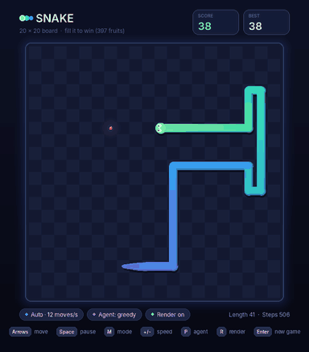

# snake-game-agent

An AI that learns to beat Snake: to fill the entire board with the snake's body.

The project chases the highest possible score and does not care about speed: the
agent may take as long as it likes to choose each move. It does not look at the
screen either; it reads the exact positions of the snake and the fruit.

<p align="center"></p>

## Roadmap

1. **A Snake game to train on** (done): an exact, deterministic engine, Gymnasium
   environments for one game or thousands at once, and an animated UI that can be
   switched off during training.
   **Documentation: [`snake_game/README.md`](snake_game/README.md)**
2. **The agent** (next): a model trained on the game's exact state to play a
   perfect game.

## Quick start

```bash
pip install -e ".[ui]"
python -m snake_game                                             # play: one move per key press
python -m snake_game --mode auto                                 # classic real-time Snake
python -m snake_game --agent hamiltonian --mode auto --speed max # watch a perfect game
```

```python
from snake_game import VectorSnakeEnv

envs = VectorSnakeEnv(num_envs=256)  # 256 games stepped together with NumPy
obs, infos = envs.reset(seed=0)      # obs: (256, 8, 20, 20) exact board encoding
```

## Model files

Trained models are stored with [Git LFS](https://git-lfs.com). Install it once
(`git lfs install`) before cloning or committing models; files matching the
patterns in [`.gitattributes`](.gitattributes) (`*.pt`, `*.pth`, `*.ckpt`,
`*.safetensors`, `*.onnx`, `*.h5`, `*.keras`, `*.zip`, `*.npz`) are then kept in LFS
automatically.

## Repository layout

| Path | Contents |
| --- | --- |
| [`snake_game/`](snake_game/) | the game: engine, Gymnasium environments, pygame UI ([README](snake_game/README.md)) |
| [`tests/`](tests/) | test suite: `pip install -e ".[dev]"`, then `pytest` |
| [`.github/workflows/`](.github/workflows/) | continuous integration |

## License

[MIT](LICENSE)
