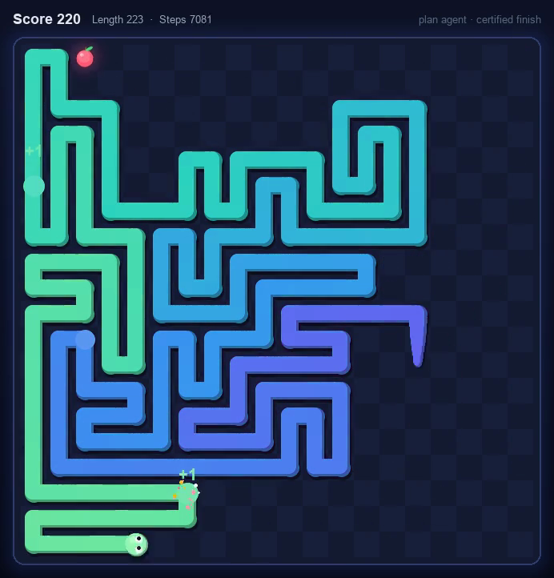
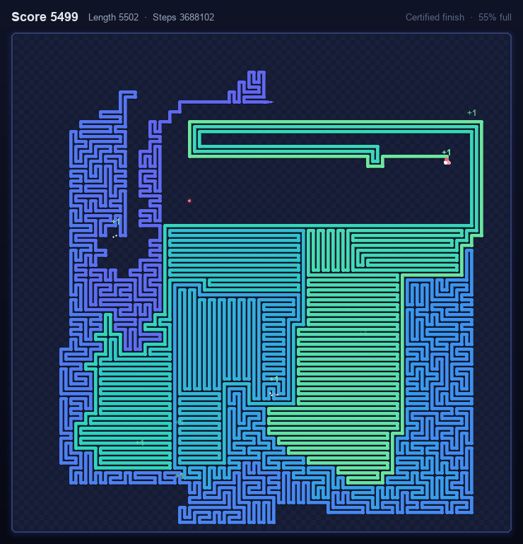

# Snake agent

The agent's side of the project, built milestone by milestone after the
[Architecture B plan](../analysis/architecture-b-review.md#3-revised-plan-for-b).
Milestone **M0, contracts and instruments**, holds the rules every agent plays
by, the exact tools that training and search use, the evaluation harness, and
an exact solution of 4×4. Milestone **M1, self-play on 4×4 and 6×6**, adds the
network inputs, the search, the network, self-play and training
([below](#m1-self-play-on-44-and-66)). Milestone **M2, 8×8 and 10×10 with
recovery**, adds board mixtures, recovery and mid-game starts, batched
assessment and a moves unit that scales with the board
([below](#m2-88-and-1010-recovery)). **Habits** then make the 10×10 agent
faster than the shortcut cycle on T1: jump biases per band of fill, compared on
paired games and distilled into the network
([below](#habits-faster-than-the-shortcut-cycle-on-1010)). Milestone **M3,
20×20**, adds adaptive search budgets, a win unit for free play and bounded GPU
memory, and meets its gate: on the test seeds the agent wins every T1 game,
faster than the shortcut cycle, and beats the reference policies on T2
([below](#m3-2020)). After M3, the **plan agent** clears the board far
faster: it plays free while the snake is short, then finishes on a
Hamiltonian-cycle certificate that it rebuilds at every fruit. On the test
seeds of 20×20 it wins 298 of 299 games in 11,047 moves on average, 46% fewer
than M3's agent ([below](#free-play-and-a-certified-finish-the-plan-agent)).
Then the plan agent gets a **Transformer**, plays **100×100**, and plays free
until 40% of the board is filled instead of 30%: its searches are compiled, and
the Transformer, trained on boards up to 20×20, clears 100×100 in 45% of the
shortcut cycle's moves; on the test seeds of 20×20 it wins all 299 games in
10,978 moves ([below](#a-transformer-100100-and-a-later-switch)). It can now
play **free to 80%** of the board: the transition waits for its certificate,
free play leaves fewer holes, and the Transformer is retrained for late free
play. Free play to 80% wins nearly every game but costs more moves than the
switch at 40%: 40% more on 20×20 and 53% more on 100×100, still 30% fewer
than the shortcut cycle ([below](#free-play-to-80)).

M0's gate is met: the tests pass, and the harness reproduces the reference
numbers of the [Architecture B probe](../analysis/architecture_b_probe.py):
every section of its results except the machine-dependent timings and the
analytic network cost model ([below](#reproducing-the-probe)).

- [Quick start](#quick-start)
- [The information contract](#the-information-contract)
- [Exact instruments](#exact-instruments)
- [Evaluation harness](#evaluation-harness)
- [4×4 solved exactly](#44-solved-exactly)
- [M1: self-play on 4×4 and 6×6](#m1-self-play-on-44-and-66)
- [M2: 8×8 and 10×10, recovery](#m2-88-and-1010-recovery)
- [Habits: faster than the shortcut cycle on 10×10](#habits-faster-than-the-shortcut-cycle-on-1010)
- [M3: 20×20](#m3-2020)
- [Free play and a certified finish: the plan agent](#free-play-and-a-certified-finish-the-plan-agent)
- [A Transformer, 100×100 and a later switch](#a-transformer-100100-and-a-later-switch)
- [Free play to 80%](#free-play-to-80)
- [Reproducing the probe](#reproducing-the-probe)
- [Package layout](#package-layout)

## Quick start

```bash
pip install -e ".[dev]"
python -m snake_agent evaluate t1 --agent shortcut --board 10x10 --games 100   # standard starts
python -m snake_agent evaluate t2 --agent guarded-greedy --board 10x10 --compare # recovery starts
python -m snake_agent solve --board 4x4                                        # exact 4x4 numbers
python -m snake_agent reproduce [--full]                                       # the probe's numbers
pytest [--slow]                                                                # --slow: full reproduction

pip install -e ".[train]"                                                      # PyTorch, for M1 to M3
python -m snake_agent train --board 6x6 --out runs/m1-6x6 --device cuda        # self-play and training
python -m snake_agent assess runs/m1-6x6/model.pt --games 300                  # the M1 gates
python -m snake_agent train --board 10x10:160 --board 8x8:48 --board 6x6:48 \
    --relative-unit 0.3 --eval-relative-unit 0.3 --out runs/m2 --device cuda   # a board mixture
python -m snake_agent assess runs/m2/model.pt --relative-unit 0.3 --sources 100  # the M2 gates (10x10)
python -m snake_agent habits runs/m2/model.pt --out runs/habits --device cuda     # jump habits, distilled
python -m snake_agent habits runs/habits/model-h02.pt --board 20x20 --seeds 120 --standard 24 --prefix 8 \
    --free 12 --recovery 12 --steps 1000 --eval-games 44 --anchor runs/habits/model-h02.pt \
    --out runs/m3-habits --device cuda                                         # 20x20 habits (M3)
python -m snake_agent assess runs/m3-habits/model-h01.pt --board 20x20 --games 299 --sources 500 \
    --relative-unit 0.3 --win-unit 0.3 --confident 0 --careful-fill 0 --split test  # the M3 gate
python -m snake_agent train --agent plans --board 10x10:128 --board 8x8:64 --out runs/plans  # plan agent
python -m snake_agent assess runs/plans/model.pt --agents plans --games 100 --sources 100      # free T1, T2
```

```python
from snake_agent import REFERENCES, TRAINING_RULES, evaluate_standard, standard_gate
from snake_agent.seeds import VALIDATION, standard_seeds

evaluation = evaluate_standard(REFERENCES["shortcut"], 10, 10, standard_seeds(VALIDATION, 100), TRAINING_RULES)
summary = evaluation.summary()
print(summary.won, summary.mean_moves)                # 100 wins in about 1,450 moves
print(standard_gate(evaluation, max_mean_moves=2425))  # passes: faster than the plain cycle
```

`--agent` takes a reference name (`random`, `greedy`, `guarded-greedy`,
`hamiltonian`, `shortcut`), `exact` or `exact-envelope` (boards up to 16
cells), or `module:attribute` naming an [`AgentSpec`](evaluation.py), a class
or a callable.

## The information contract

[`contract.py`](contract.py) fixes what an agent sees, what it does and what
counts as success. Training, search and evaluation all follow it.

1. **Public state only.** The agent receives a `GameState`: board size, ordered
   body, heading, visible fruit and move counters, plus the `Rules` in force.
   It never gets the live `SnakeGame`, whose clones replay the hidden fruit
   stream, nor seeds or future fruits. Planning starts from
   `planning_game(state, seed)`, which keeps the visible fruit and draws later
   ones from an independent seed. The harness hands agents `GameState`
   objects only, and their seeds (`AgentSpec.factory(seed)`) are unrelated to
   the fruit seeds.
2. **Relative actions.** One `RelativeAction` per move: left, straight or
   right. The harness also accepts the absolute `Direction` that the game's
   reference policies return; a bare `int` is rejected because it would be
   ambiguous. `as_policy(agent)` adapts an agent for the game window.
3. **Safety strictly first.** The agent maximizes the probability of filling
   the board. Fewer moves only decide between equally safe moves:
   `choose_safely(win_values, moves, allowed)` breaks only exact ties. On
   standard starts every move stays inside the cycle-order envelope, where
   every move keeps the win certain (below), so there speed decides. The plan
   agent follows later decisions of the owner: it plays free on standard
   starts, accepting a slightly lower clear rate for fewer moves, and finishes
   on a Hamiltonian-cycle certificate of its own, rebuilt at every fruit
   ([below](#free-play-and-a-certified-finish-the-plan-agent)).
4. **Fruit timeout as a loss.** Under `TRAINING_RULES` a game is lost after
   `N + L` consecutive moves without fruit (`N` cells, `L` the current length):
   `Rules.timeout`, `Rules.timed_out`. The budget features of decision 3 are
   `Rules.budget_features(state)`: enabled 1, configured `(N + L) / N`,
   remaining `(N + L - moves since fruit) / N`. `NO_LIMIT` is the engine's own
   rules, for the evaluation check without a limit.
5. **Outcomes.** `Outcome.WON`, `LOST` (collision), `TIMED_OUT` (the timeout,
   also a loss) and `CENSORED` (stopped unresolved by the evaluation: a loop,
   a stall or a move cap). Censored games are never counted as wins or losses.

## Exact instruments

**Survival analysis** ([`survival.py`](survival.py)) works on `Board`, the
timestamped body of `VectorSnakeEnv`, and reasons about the snake moving
without eating.

- `Board.has_survival_certificate()`: a shortest path through free cells
  reaches a body cell that has moved away by the time the head arrives, so the
  snake can circle its own body forever (`Board.certificate_loop()` returns the
  loop). It treats the fruit as a free cell, so it holds for the snake that
  does not eat: a search hint and an input feature, never a reason to prune.
- `prove_lost(board, budget)`: exact search over the continuations without
  eating. Eating only lengthens the body, so if every one of them collides the
  real game is lost, unless the snake fills the board first. The search
  therefore refuses proofs that need as many moves as there are free cells; the
  probe's version did not. Without that check, the 3×3 snake
  `((0,0), (1,0), (1,1), (1,2), (2,2), (2,1), (2,0))` heading left with the
  fruit at (0,1) is "proven lost", yet it wins by eating twice. With it, every
  "lost" verdict on the 159,776 states of 3×3, 3×4 and 4×4 has exact value 0.
- `classify_moves(state, budget)`: each relative action is `FATAL`, `WON`,
  `CERTIFIED`, `LOST` (proven) or `UNKNOWN`. Search prunes only `FATAL` and
  `LOST`.

**Cycles** ([`cycles.py`](cycles.py)). A body is in cycle order when, read from
tail to head, it advances less than one lap around a Hamiltonian cycle.
`CycleEnvelope` holds the moves that enter a cell further along the cycle
without passing the tail or the fruit. They are safe, keep cycle order and
reach every fruit within `N` moves, so a game played inside the envelope is
certainly won, and the next cell of the cycle is always available. The
envelope of a standard start (`CycleEnvelope.for_state`) uses the first cycle of
`snake_game.policies.hamiltonian_cycles` that the start is aligned with.
`ShortcutCyclePolicy` takes the envelope's longest jump while the snake fills
less than half the board, then follows the cycle: the T1 speed reference.

**References** ([`references.py`](references.py)). `REFERENCES` describes the
reference policies for the harness: the game's `random`, `greedy` and
`hamiltonian`, the `shortcut` cycle and `GuardedGreedyPolicy` (greedy among the
moves that keep a certificate). They make the probe's moves: the games
[reproduced below](#reproducing-the-probe) match move for move.

**Recovery starts** ([`recovery.py`](recovery.py)). `recovery_starts` takes,
from each guarded-greedy game, the first certified state at 30%, 50% and 70%
occupancy that no Hamiltonian cycle is aligned with. These are T2's starts.

## Evaluation harness

[`evaluation.py`](evaluation.py) plays games on `SnakeGame` directly, records
an outcome class, move and fruit counts, the longest stretch without fruit and
the closest approach to the timeout (`timeout_margin`), and summarizes them
with exact Clopper-Pearson intervals ([`stats.py`](stats.py)).

| Track | Starts | Rule | Gate |
| --- | --- | --- | --- |
| **T1** `evaluate_standard` | standard start, one game per fruit seed | the agent must stay inside the envelope; leaving it is recorded (`envelope_exit`) | `standard_gate`: every game won, no envelope exit, mean moves below the reference (shortcut cycle: 214 on 6×6, 1,445 on 10×10, 20,737 on 20×20) |
| **T2** `evaluate_recovery` | recovery starts, one fruit seed each | free choice | `recovery_gate`: in every band, the 95% lower bound of the win rate above the best reference's rate (`best_rates`) |
| **T3** `evaluate_t3` | T1 and T2 | only for `Provenance.SELF_PLAY` agents | as T1 and T2 |

- **Rules.** `TRAINING_RULES` (default) ends loops as timeouts. With `NO_LIMIT`
  a game is censored when a deterministic agent repeats a state since the last
  fruit (`"loop"`; `AgentSpec.memory` adds the agent's internal state to the
  comparison) or after more than `20 N` moves without fruit (`"stall"`).
  Evaluate final models both ways.
- **Provenance.** Each result carries the agent's `Provenance`:
  `REFERENCE`, `DEMONSTRATIONS` (reported as "T1 (with demonstrations)") or
  `SELF_PLAY` (reported as T3).
- **Win intervals with censoring.** `Summary.win_interval` counts censored games
  as lost for the lower bound and as won for the upper bound.
  `Summary.failure_bound` is the one-sided 95% upper bound on games not won:
  299 failure-free games bound it below 1%.
- **Held-out seeds** ([`seeds.py`](seeds.py)). `TRAIN` (0 to 10⁹) is for
  training and experiments, `VALIDATION` for development runs, `TEST` for the
  final gates; `check_training_seed` rejects held-out seeds. Inside a held-out
  range, standard games, recovery source games and recovery fruit streams use
  separate blocks (`standard_seeds`, `recovery_source_seeds`,
  `recovery_fruit_seeds`).

## 4×4 solved exactly

[`exact.py`](exact.py) enumerates all 144,088 running states of 4×4 (27,960
bodies with each fruit) and, under the training rules, every number of moves
left before the timeout: 3.7 million states, solved in about a second. It
gives each state's best win probability and the value of each action
(`value`, `action_values`, `regret`), the fewest expected moves among certain
wins (`moves`), and the same restricted to the envelope (`solve(...,
envelope=...)`). `evaluate_policy` computes a policy's exact results. A brute
force through the real engine agrees on every state of 2×3, 3×2, 2×4 and 3×3.

From the standard 4×4 start (expected moves, averaged over the first fruit):

| Strategy | Win probability | Expected moves |
| --- | ---: | ---: |
| Plain cycle | 1 | 52.00 (exactly `F(F+3)/4`) |
| Shortcut cycle (jumps below 50% fill) | 1 | 43.89 |
| Best possible inside the envelope | 1 | 43.08 |
| Best possible with any certain win | 1 | 35.47 |

Two measurements bear on the owner's decisions:

- **The envelope costs moves.** On 4×4 the best certain win needs 18% fewer
  moves than the best one inside the envelope. Decision 2 keeps T1 inside the
  envelope, so 43.08 is the T1 optimum there; the larger certified sets of the
  review, such as switching cycles after a fruit, are the way to recover part
  of the difference.
- **The timeout costs a few states.** Under the `N + L` rule, 184 of the
  144,088 states lose win probability (lengths 11 to 14; 72 certain wins at
  length 14 become losses because every safe route needs more than `N + L`
  moves without fruit). The standard start stays a certain win, and the best
  expected moves change by 3 × 10⁻⁶.

## M1: self-play on 4×4 and 6×6

M1 trains the plan's network from scratch by self-play with search, on 4×4 and
6×6, without demonstrations (track T3). Its gate: on 6×6 T1, no failures and
mean moves below the shortcut cycle's 214; on 4×4, values calibrated against
the exact solution; raw-policy and search results both reported. PyTorch is an
optional dependency: `pip install -e ".[train]"`.

### Network inputs

[`encoding.py`](encoding.py) encodes one state per evaluation, turned so that
the snake heads up: the three relative actions then always enter the cells left
of, above and right of the head, and only the left-right mirror remains as a
symmetry (`mirror`, for augmentation). Everything is exact preprocessing of the
public state, measured in cells where that matters for transfer across sizes:

- 25 cell planes: the body and its release times, the fruit, the free cells the
  head can reach and how far, the slack of the body cells at the edge of that
  region (the survival certificate's ingredients), segment directions, the
  canonical cycle (distance ahead, next cell, the envelope's free arc, the holes
  behind the tail) and the distances to the walls;
- 8 features per action: its move class (`classify_moves`), whether it eats,
  and whether it is inside the envelope and how far it jumps;
- 11 global features: occupancy, the timeout budget of decision 3, the
  afterstate flag, cycle order and a few distances.

No plane holds coordinates, and boards sit in the corner of a larger canvas
when sizes are mixed. The moves head works in units of `moves_scale(F) =
F(F + 3) / 4`, the plain cycle's expected moves to fill `F` free cells.

### Search

[`search.py`](search.py) is Gumbel root search (Danihelka et al., *Policy
improvement by planning with Gumbel*, 2022): sequential halving over the root's
moves, completed Q-values, and the improved policy `softmax(logits + σ(q))` as
the policy target, with 16 simulations at every move that has a choice. The
contract picks one of two modes at the root:

- **Envelope mode**, on every standard start: only envelope moves are searched.
  Each keeps the win certain, so the search compares expected moves, in steps
  of one move (`moves_unit`) rather than rescaled to [0, 1] at each node as the
  paper does with values: rescaling turns differences of a fraction of a move
  into full-size ones, so the search follows the moves head's errors.
- **Free mode** elsewhere: the win probability decides, and expected moves only
  order moves whose win values tie exactly. A learned win value stays below 1
  (`CERTAIN`), so only exact wins tie: the envelope and a filled board. A state
  in cycle order is such an exact win, a leaf with win value 1.

A move that eats ends the simulation at its *afterstate*, the board before the
next fruit appears; later visits draw the fruit from the search's own
generator. Fatal moves and moves that time out are pruned, and in free mode
moves back to a position of the current fruit's epoch, and at the root moves
that `prove_lost` proves lost. The search is a generator, so that a driver can
batch the leaves of many games into one network call. `SearchAgent` plays its
moves; `PolicyAgent` plays the network's most likely move among the same
moves, without search.

**Moves are counted only in won games.** The second value of a node is the
expected moves until the board is full *if it is filled*: backups weight moves
by the win value, and the moves head trains on won games only. The review
counted a loss as a maximum instead, and the first draft of the search clipped
moves at twice the plain cycle's pace. Both distort slow wins: late in a game a
fruit that appears in a hole behind the tail costs most of a lap. On 4×4 with
two cells free, the best certain win takes 3.3 times the plain cycle's pace on
average and up to 12.4 times, so the clip made late moves look alike. Weighting
by the win value keeps dying from ever looking fast, since a loss contributes
no moves, and needs no ceiling (`moves_ceiling` only bounds the network's
output).

The tests check the search against the exact 4×4 solution. With exact leaf
values, a search that visits each root move once sees every move's exact win
probability and, among certain wins, its exact expected moves, and picks the
contract's best move. With an ideal network (exact values, a prior on the best
move), 16 simulations play every sampled state optimally, and the search agent
plays T1 at the envelope's optimum of 43.08 moves.

### Network

[`network.py`](network.py) is a residual CNN (64 channels, 6 blocks of two 3×3
convolutions with a global-pooling bias, 0.6 M parameters by default), masked
to the board's cells: a 4×4 board gives the same outputs on its own canvas and
padded into a 6×6 one. The policy head scores each action from the features of
the cell it enters, its per-action features and a summary of the board; the
win head gives a logit and the moves head a non-negative number of
`moves_scale` units. `NetworkEvaluator` answers the search's queries.

### Self-play and training

[`selfplay.py`](selfplay.py) plays many games in one process, all sharing each
network call. A game starts from the standard start or from a *free start*: a
running state of a reference policy's game that is not a certain win inside
the envelope, so that the network also learns win probabilities. Every move
gives an example of the state before it, and every eating move one of its
afterstate. The targets, each win target with its provenance (`Label`):

| Target | Value |
| --- | --- |
| Policy | the search's improved policy, at moves searched and not lost |
| Win | exact 1 inside the envelope, exact 0 when every move is fatal, proven lost or times out; otherwise the outcome blended with the search's value, `0.5 z + 0.5 v` |
| Moves (won games) | a TD(λ) return over the game's fruits, in `moves_scale` units: the moves until the visible fruit is eaten, then `(1 - λ) V + λ G` at the afterstate, with `V` the network's value and `G` the return from there (`moves_returns`; λ = 1 is the moves the game still took) |

[`train.py`](train.py) runs generations: self-play with the current network
across worker processes (on a GPU, each worker evaluates its games' leaves
there in batches), a replay buffer of the most recent examples, optimizer steps
on minibatches with random left-right mirroring (cross-entropy for the policy,
binary cross-entropy for the win value, a Huber loss for the moves), and an
assessment every few generations. Seeds are training seeds, a block per
generation.

[`assess.py`](assess.py) measures a network against the M1 gates on held-out
seeds: T1 and T2 for the search and the raw policy, with the exact solutions'
view where they exist. On boards up to 6×6, `solve_envelope` scores every T1
decision by the expected moves it adds to the envelope's optimum. On 4×4, it
also measures the calibration of the win head on the states the agents visit
and on states drawn uniformly outside the envelope, and the win probability
each free decision gives up.

### Results

The runs used a rented RTX 4090 server whose container is capped at about six
CPUs, which bound self-play: workers ran the network on the GPU in batches, and
a 6×6 generation took about a minute (45 s of self-play, 15 s of training).
Default network, 480 self-play games per generation, 16 simulations, and 300
(4×4) or 1,000 (6×6) optimizer steps of 512 examples per generation. Numbers
are on validation seeds unless marked *test*. "Extra moves" are exact: the
expected moves a decision adds to the envelope's optimum, averaged over T1
decisions with a choice.

**4×4** (30 generations, half the games from free starts; 1,000 T1 games, 245
T2 starts):

| Agent | T1 mean moves | Extra moves per decision | T2 won | Free decisions optimal |
| --- | ---: | ---: | ---: | ---: |
| Raw policy | 43.52 (exactly 43.63) | 0.098 | 245 of 245 | 99.94% |
| Search, 16 simulations | 43.51 | 0.096 | 245 of 245 | 99.94% |
| Search, 64 simulations | 43.10 | 0.049 | 245 of 245 | 100% |
| Optimum inside the envelope | 43.08 | 0 | 245 of 245 | |
| Shortcut cycle | 43.89 | | | |

Every T2 start is a certain win; the best reference wins 98%, 92% and 64% of
the bands. The win head is calibrated: against the exact values, its expected
calibration error is 0.0017 (mean absolute error 0.0017) on the 1,714 states
outside the envelope that the search visits in T2 games, and 0.018 (mean
absolute error 0.037) on 5,000 states drawn uniformly outside the envelope,
most of which play never reaches.

**6×6** (a quarter of the games from free starts). The first run trained the
moves head on the moves each game still took (λ = 1) and searched with Q
rescaled to [0, 1]; the second used TD returns over fruits (λ = 0.5) and the
one-move unit. The raw policy on T1 (mean moves over 1,000 games, 200 or 300
at generation 10; extra moves over 200 to 300 games):

| Generation | Mean moves, λ = 1 | Extra moves, λ = 1 | Mean moves, λ = 0.5 | Extra moves, λ = 0.5 |
| ---: | ---: | ---: | ---: | ---: |
| 10 | 225.9 | 0.38 | 213.3 | 0.26 |
| 20 | 212.5 | 0.24 | **210.5** | **0.18** |
| 30 | 212.9 | 0.22 | 212.6 | 0.20 |
| 40 | (stopped) | | 214.9 | 0.26 |

Every T1 game was won inside the envelope. TD returns cut the moves head's loss
four- to fivefold and reached in 10 generations what the outcomes took 20 for.
Both runs peaked by generation 20; the search is why (below).

**The M1 gate, test seeds** (generation 20 of the λ = 0.5 run and the search
settings chosen on validation; 1,000 T1 games each):

| Agent | Won | T1 mean moves (95% interval) | Extra moves per decision | Gate (below 214) |
| --- | ---: | ---: | ---: | --- |
| Raw policy | 1,000 | 210.37 (209.07–211.67) | 0.166 | passed |
| Search, 16 simulations, 16-move unit | 1,000 | 209.43 (208.11–210.76) | 0.160 | passed |
| Search, 64 simulations, 4-move unit | 1,000 | 208.84 (207.51–210.17) | 0.156 | passed |
| Shortcut cycle (exact) | certain | 212.78 | | |
| Optimum inside the envelope | certain | 201.91 | 0 | |

No game left the envelope. On 6×6 T2 (test seeds, 158 recovery starts), the
search wins 155 (59 of 60, 56 of 57 and 40 of 41 by band) and the raw policy
151, against 98%, 61% and 41% for the best reference (T2 is M2's gate, on
10×10).

**What limits the search.** On 6×6 the search adds little to the raw policy:
with 16 simulations and the one-move unit it plays worse (0.29 extra moves per
decision against 0.18 at generation 20). Against `solve_envelope`, the moves
head misjudges the difference between two sibling moves by 3 to 5 moves early
in the game (17 or more cells free), where the best and second-best moves
differ by 0.6 to 1.5; its one-step ranking agrees with the exact one about 60%
of the time. The search therefore follows the moves head's noise, and the
policy, which learns from the search, stops improving and then gets worse
(generations 30 and 40). Trusting values less helps: with a 16-move unit at 16
simulations, or 64 simulations and a 4-move unit (`assess --moves-unit`), the
search beats the raw policy slightly on the test seeds. On 4×4, where the moves
head is accurate enough, the one-move unit is best and more simulations reach
the optimum. Making the moves head rank close moves is the open problem for M2:
the policy narrows the states it visits, so siblings it does not play are
rarely trained on (the error grows from 3.0 moves at generation 10 to 4.8 at
30).

### Training on the moves the policy does not play

Two options give the moves head positions that the policy's own games rarely
show, which the search must still judge:

- **Random prefixes** (`--prefix-share`, `prefix_starts`): a game starts from the
  standard start, plays uniformly random envelope moves until the snake reaches
  a length drawn up to `--prefix-fill` of the board, then hands over to the
  agent; only the agent's moves give examples. Random jumps leave holes in
  places the policy would not.
- **Sibling examples** (`--sibling-visits`): every envelope move the search
  visited at least that often but did not play gives an example of the position
  it leads to, with the search's value of the move as its moves target
  (`Label.SIBLING`).

`assess` measures the problem directly (`sibling_ranking`): at each T1 decision
with a choice, the error of each move's one-step value relative to the played
move's, against `solve_envelope`, and the share of pairs of moves ordered as
the exact solution orders them, for each half of the game (the first: at least
half the board free, where moves differ by little). Runs as in M1 (λ = 0.5);
the prefix runs start 37.5% of the games after a prefix (fill up to 75%) and
25% from free starts:

| Run | Generation | Raw policy: T1 moves | Raw policy: extra moves | Search: extra moves | First half: error | First half: agreement | Second half: agreement |
| --- | ---: | ---: | ---: | ---: | ---: | ---: | ---: |
| M1 | 10 | 213.3 | 0.26 | 0.34 | 3.0 | 0.61 | 0.73 |
| M1 | 20 | 210.3 | 0.17 | 0.29 | 4.7 | 0.58 | 0.80 |
| M1 | 30 | 211.5 | 0.20 | 0.45 | 4.9 | 0.56 | 0.83 |
| M1 | 40 | 213.7 | 0.26 | 0.39 | 4.5 | 0.54 | 0.83 |
| Prefixes | 10 | 211.1 | 0.19 | 0.22 | 3.2 | 0.65 | 0.74 |
| Prefixes | 20 | **208.3** | **0.11** | 0.29 | 3.8 | 0.55 | 0.81 |
| Prefixes | 30 | 210.5 | 0.17 | 0.34 | 4.6 | 0.57 | 0.85 |
| Prefixes and siblings, first run | 10 | 213.6 | 0.29 | 0.26 | 3.6 | 0.56 | 0.78 |
| Prefixes and siblings, first run | 20 | 213.2 | 0.22 | 0.27 | 4.1 | 0.63 | 0.93 |
| Prefixes and siblings | 10 | 213.7 | 0.25 | 0.23 | 3.0 | 0.61 | 0.75 |
| Prefixes and siblings | 20 | 213.7 | 0.21 | 0.29 | 3.5 | 0.53 | 0.88 |
| Prefixes and siblings | 30 | 218.6 | 0.28 | 0.32 | 4.0 | 0.51 | **0.94** |
| Prefixes and siblings | 40 | 217.7 | 0.29 | 0.37 | 3.7 | 0.52 | **0.94** |

The raw policy's numbers are over 300 validation games, the search's (16
simulations, one-move unit) over 200; "error" is in moves, "agreement" the
share of pairs ordered as the exact solution orders them.

- **Random prefixes make a better policy.** Its best checkpoint (generation 20)
  averages 209.0 moves on 1,000 validation games against 210.5 for M1's, and
  the 16-simulation search with a 16-move unit costs 0.13 extra moves per
  decision against 0.17 (300 games each). They do not stop the ranking in the
  first half from degrading, nor the decline after generation 20.
- **Sibling examples make a better moves head late in the game, not a better
  agent.** Two runs (the first stopped at generation 20, the second run to 40
  with other seeds) order 88% to 94% of second-half pairs as the exact solution
  does, against 80% to 85% without them. The first half does not improve: 63%
  and 53% at generation 20 in the two runs, which also shows how much this
  measure varies between runs. The policy is worse throughout (the runs' best
  checkpoints average 213.2 and 213.7 moves, against 208.3 with prefixes
  alone) and declines after generation 20 as well (217.7 at generation 40).
  Continuing the first run from generation 20 with `--init`, so with an empty
  replay buffer and a fresh optimizer, collapsed within ten generations (220.9
  moves): a restart needs the replay buffer too.
- **Open.** In every run the policy peaks around generation 20 and then
  declines while the losses keep falling, whatever the values late in the game.
  Early in the game no variant orders close moves much better than chance:
  they differ by 0.6 to 1.5 moves out of about 170 still to come. Next steps: a
  decaying learning rate or fewer updates per generation against the late
  decline, and value targets precise enough for the first half. (M2 traced the
  decline: self-play searched with the one-move unit, whose improved policy, the
  policy target, is worse than the raw policy from generation 10 on; see
  [the moves unit](#the-moves-unit-a-share-of-the-scale).)

## M2: 8×8 and 10×10, recovery

M2 grows the network to 8×8 and 10×10 and to recovery starts. Its gate, on
10×10: T1 with no failures and mean moves below the shortcut cycle's 1,445; T2
beating the best reference policy in every occupancy band, the 95% lower bound
of the win rate above that policy's rate on the same starts. The plan also asks
for mixed sizes, replayed mid-game starts, a sweep of the search budget (8, 16,
32 and 64 simulations) at equal compute, and the measured games to a plateau
and throughput, which size the 20×20 run of M3.

**Status:** T2 is met, on the test seeds by both agents. T1 was first met only by
the letter: on 1,000 test games the raw policy of the checkpoint chosen on
validation averages 1,444.5 moves, under the gate's 1,445 by half a move, but
the shortcut cycle averages 1,435.1 on the same games
([the gate](#the-m2-gate-test-seeds)). The agents plateau near the shortcut
cycle's pace, and the cause is pinned down
([below](#why-t1-stops-short-of-the-shortcut-cycle)). Habit rounds from that
checkpoint then make both agents faster than the shortcut cycle on the same
games: by 28.9 moves for the raw policy and 30.1 for the search on the 1,000
test games, with T2 still passed
([below](#habits-faster-than-the-shortcut-cycle-on-1010)).

### What M2 adds

- **Board mixtures** (`--board 10x10:160 --board 8x8:48 --board 6x6:48`): each
  generation plays that many games on each board. Their examples share one
  canvas, the largest board's, and the assessments use the largest board.
- **Two more kinds of start** (`selfplay.KINDS`), besides M1's standard, prefix
  and free starts: *recovery starts* (`--recovery-share`, `recovery_start`),
  track T2's kind of start (a certified state that no cycle is aligned with)
  taken from a guarded-greedy game of a training seed; and *mid-game starts*
  (`--midgame-share`, `midgame_start`), a state of one of the agent's own
  earlier games replayed with new fruits (review §2.6). Each game leaves a few
  states for later mid-game starts (`--midgame-samples`). The workers build the
  starts, so the guarded-greedy games behind recovery starts run in parallel.
- **A relative moves unit** (`--relative-unit`, `SearchConfig.relative_unit`):
  the envelope search compares expected moves in a share of `moves_scale` at the
  node instead of a fixed number of moves ([below](#the-moves-unit-a-share-of-the-scale)).
- **Training settings** for runs that start from a checkpoint (`--init`): a
  learning-rate warm-up (`--warmup`), a cosine decay (`--lr-floor`), and no
  updates before the buffer holds `--min-replay` examples.
- **Throughput.** The starts go to the workers by the longest-processing-time
  rule, priced by the last generation's network evaluations per game of their
  board and kind, and the log records moves and evaluations per second and how
  busy the workers were. With many workers on one GPU, run NVIDIA's
  Multi-Process Service (`nvidia-cuda-mps-control -d`): without it the workers'
  small batches take turns on the GPU, and 10×10 self-play runs 2.5 to 3.5
  times slower.
- **Batched assessment.** The harness's game loop is a stepper
  (`evaluation.GameRun`), so `assess` plays a worker's games at once and
  evaluates their pending leaves in one batch on the GPU (`play_lockstep`). The
  batched games play exactly what `SearchAgent` and `PolicyAgent` play one game
  at a time (the tests check this move for move). A 10×10 assessment (100 T1
  games and about 220 T2 starts, both agents and the references) takes 3 to 4
  minutes. `assess` also applies the T2 gate (`recovery_gate`).

### The moves unit: a share of the scale

The moves head predicts in units of `moves_scale(F)`, so its errors grow with
it: about 300 moves at the 6×6 start, 2,425 at the 10×10 start, 39,700 on 20×20.
A fixed unit suited to one board is wrong for the next. The M1 network on 10×10
T1 (100 validation games, 16 simulations):

| Search unit | Mean moves | | Relative unit | Mean moves |
| --- | ---: | --- | --- | ---: |
| 4 moves | 1,562.6 | | 0.01 of the scale | 1,567.3 |
| 16 moves | 1,535.2 | | 0.03 | 1,510.9 |
| 64 moves | 1,516.7 | | 0.1 | 1,471.9 |
| 256 moves | 1,474.6 | | 0.3 | **1,452.3** |
| Raw policy | 1,494.6 | | Raw policy | 1,494.6 |

On 6×6 (300 games) the same shares give 215.9, 213.2, 209.6 and 207.3 moves
against 208.3 for the raw policy: 0.3 is the only share where the search beats
the policy on both boards. The improved policy is the policy target, so a unit
too small for the moves head makes the targets worse than the policy itself.
The first 10×10 run, self-play with the one-move unit, made the raw policy
worse within five generations (1,494.6 to 1,732.9 moves; its search at a 4-move
unit, 1,645.7, was still better than its policy). With a 0.3 share in self-play
and assessment, the policy improved instead (1,472.2 at generation 5).

### Why T1 stops short of the shortcut cycle

The main run (`runs/m2-main`): the three boards above, 10% free, 15% prefix
(fill up to 75%), 25% recovery and 20% mid-game starts, the rest standard; 16
simulations at a 0.3 share; 400 steps of 512 examples per generation, a buffer
of a million, warm-up over 3 generations, cosine decay to a tenth; starting
from M1's best checkpoint (`runs/m1-6x6-prefix/model-020.pt`). Validation seeds:
the raw policy over 300 T1 games (95% intervals about ±10 moves), the search
over 100 (±16), and the T2 starts of 100 source games (98, 73 and 46 by band):

| Generation | 10×10 games | T1 raw policy | T1 search | T2 raw policy | T2 search |
| ---: | ---: | ---: | ---: | --- | --- |
| 0 (M1's network) | 0 | 1,482.3 | 1,452.3 | 67, 46, 41: fails | 98, 65, 45: passes |
| 5 | 795 | **1,463.2** | 1,471.9 | 65, 56, 43: fails | 97, 62, 46: passes |
| 10 | 1,588 | 1,470.6 | 1,479.5 | 80, 58, 44: passes | 98, 69, 44: passes |
| 15 | 2,381 | 1,472.3 | 1,487.7 | 84, 56, 39: passes | 97, 68, 44: passes |
| 20 | 3,180 | 1,476.4 | 1,487.7 | 87, 69, 45: passes | 98, 72, 46: passes |

T2 counts are games won per band; the best reference wins 63%, 36% and 24% of
these starts. Every T1 game was won inside the envelope. A generation (256
games, 160 of them on 10×10) took about 100 seconds of self-play and 10 of
training, with 13,600 network evaluations a second and the workers 77% to 83%
busy; an assessment took 200 seconds.

T1 peaks after about 800 10×10 games and then drifts back, as M1's runs did
once the search stopped improving on the policy: by generation 10 it no longer
does at any setting (1,476.7 to 1,512.1 at shares from 1.0 down to 0.03, and
1,484.8 and 1,493.0 with 64 simulations, against 1,479.0 for the policy, 100
games each). Hybrids of the best policy (generation 5) and the shortcut
cycle's rule locate the loss (300 games each, ±10 moves):

| Agent | Mean moves |
| --- | ---: |
| Raw policy | 1,463.2 |
| Shortcut cycle | 1,442.2 |
| The policy to 25% fill, then the shortcut rule | 1,436.5 |
| The shortcut rule to 25% fill, then the policy | 1,462.4 |
| The shortcut rule to 50% fill, then the policy | **1,429.5** |

The policy plays the first quarter and the second half better than the
shortcut cycle, and gives away about 33 moves between 25% and 50% fill, where
it jumps less than the cycle's longest-jump rule. Over the 150 or so decisions
in that range that is a fifth of a move each, and single decisions are
near-ties: at 300 of them (generation 20), each move followed by the shortcut
rule to the end, averaged over 16 fruit seeds shared by the moves, the
policy's move costs 0.07 moves more than the longest jump on average, and the
longest jump is better in 51% of them. The moves head's sibling differences do
not correlate with these rollout differences (r = −0.09). Trusting the head
more in the first half only makes the search worse (shares of 0.003 to 0.03
below 50% fill: 1,514.8 to 1,560.2 moves). The shortcut cycle wins by a habit,
jumping consistently while the snake is short, whose value shows over a whole
trajectory and not in any one decision a one-step search compares. Closing the
gap needs a training signal at that level, or values far more precise than
these.

### The search budget at equal compute

Four runs side by side (`runs/m2-sweep-*`), 5 workers each, with the main run's
mixture and settings except the budget, all from M1's network. Each budget's
games per generation follow its measured cost per 10×10 game (below), and its
steps, buffer and minimum buffer follow the examples those games give, so that
every generation of every run spends about 0.7 million network evaluations.
Validation seeds; the raw policy over 300 T1 games (±10 moves):

| Simulations | Games per generation (10×10, 8×8, 6×6) | Self-play per generation | T1 raw policy, generation 10 | T1 raw policy, generation 20 |
| ---: | --- | ---: | ---: | ---: |
| 8 | 178, 59, 59 | 123 s | 1,464.4 | 1,463.8 |
| 16 | 96, 32, 32 | 146 s | 1,461.0 | 1,472.8 |
| 32 | 47, 16, 16 | 217 s | 1,475.1 | 1,496.2 |
| 64 | 22, 7, 7 | 297 s | **1,450.7** | 1,496.0 |
| 64, another seed, twice the games | 44, 14, 14 | 300 s (12 workers) | 1,474.6 | |

Both agents pass T2 at every assessment of every run (100 source games each),
and no run's search beats its raw policy on T1 (the 64-simulation run's
generation 10: 1,458.1 at 16 simulations, 1,459.7 at 64, against 1,453.2 for
its policy over the same 100 games). At equal evaluations the budget matters
little for what the network learns: generation 10 of the 64-simulation run came
within 6 moves of the gate, but its replication on another seed did not
(1,474.6), and both of its later checkpoints fell back, as do the 16- and
32-simulation runs. The high budgets fall back hardest: they play the fewest
games per generation and keep the smallest buffers. In wall-clock time low
budgets win clearly, because their many games fill the workers' batches: the
same evaluations took 2.4 times longer at 64 simulations (7 games per worker)
than at 8 (59 per worker).

### The M2 gate, test seeds

The checkpoint is the one with the lowest raw-policy T1 mean on validation (300
games) among those whose agents both pass T2 there: generation 10 of the
64-simulation run (1,450.7). Choosing the best of 13 checkpoints favors a lucky
one, and this one is: its replication reached 1,474.6 and its own run 1,496.0
ten generations later. The test seeds give it an unbiased measure: 1,000 T1
games, and the T2 starts of 300 source games (290, 217 and 138 by band); the
search uses 16 simulations and a 0.3 share.

| Agent | T1 won | T1 mean moves (95% interval) | T1 gate (below 1,445) | T2 won by band (95% lower bounds) | T2 gate |
| --- | ---: | ---: | --- | --- | --- |
| Raw policy | 1,000 | 1,444.52 (1,438.81–1,450.23) | passed | 288, 193, 126 (0.975, 0.840, 0.853) | passed |
| Search | 1,000 | 1,448.57 (1,443.11–1,454.03) | failed | 280, 184, 121 (0.938, 0.793, 0.810) | passed |
| Shortcut cycle | 1,000 | 1,435.1 | | | |
| Best reference policy | | | | 67.6%, 46.5%, 31.9% | |

No game left the envelope. The gate's 1,445 is the probe's shortcut-cycle mean
on other seeds; on these 1,000 games the cycle is 9.4 moves faster than the
policy (about two standard errors), so the raw policy passes the T1 gate as
written without beating the cycle. T2 is a clear pass: in every band the 95%
lower bound of both agents' win rates is at least 0.79, where the best
reference wins at most 68%.

### Throughput, and the size of a 20×20 run

On the server (an RTX 4090 and a 24.5-CPU container quota, 22 workers, MPS),
the cost of self-play is the cost of a network evaluation, the leaf's expansion
(move classes, the survival certificate, the encoding) and the batched network
call together: games per hour fall in proportion to the simulations. M1's
network on 10×10 standard starts, 6 games per worker (`runs/m2-bench`):

| Simulations per searched move | Games per hour | Mean moves | Evaluations per second |
| ---: | ---: | ---: | ---: |
| 8 | 11,900 | 1,677 | 13,900 |
| 16 | 6,410 | 1,603 | 15,000 |
| 32 | 3,130 | 1,556 | 14,500 |
| 64 | 1,460 | 1,534 | 14,200 |

(Self-play keeps its Gumbel noise, so these games are slower than T1's.) Free
starts cost the same per evaluation (5,350 games an hour at 16 simulations).
Larger batches help: with 48 positions per worker, an evaluation costs a
worker 0.8 to 1.1 ms on 10×10, 0.9 to 1.5 ms on 14×14 and 1.3 to 2.0 ms on
20×20 (free and envelope positions), so 20×20 needs only 1.5 to 2 times 10×10's
work per evaluation for four times the cells. A 20×20 game at the shortcut cycle's
pace is about 20,700 moves, a third of them searched, about 110,000
evaluations at 16 simulations: 7 to 10 seconds of this server, 360 to 540
games an hour. The review's 3,000-game 20×20 run would take 6 to 8 hours here.
On 10×10, T1 peaked after about 800 games from M1's network, while T2 kept
improving for at least 3,200.

## Habits: faster than the shortcut cycle on 10×10

M2's 10×10 agents stop a few moves short of the shortcut cycle on T1 because
what the cycle does better is a habit, jumping while the snake is short, that no
single decision shows ([above](#why-t1-stops-short-of-the-shortcut-cycle)).
[`habits.py`](habits.py) adds a training signal at that level: a bias toward
longer or shorter jumps in each band of fill, compared on paired games that
share their fruits and then distilled into the network. No reference moves are
used: the habits are compared on the agent's own games, and the result is still
a self-play agent (track T3). Four distillations from M2's checkpoint give a
network whose raw policy averages 1,406.2 moves on the 1,000 test T1 games,
28.9 fewer than the shortcut cycle on the same games (95% interval 24.9 to
32.9), its search 30.1 fewer, and both still pass T2
([the gate](#validation-and-the-gate)).

### One decision is lost in the noise

From states of shortcut-cycle games on 10×10, two continuations that differ in
one move and then follow the same rule, with the same fruit seed, almost always
*merge*: they reach the same body and fruit at the same length, after which the
two games coincide. Until then they drift apart. The standard deviation of the
difference in moves, over 16 fruit seeds at each of 40 states per fill:

| Fill | Standard deviation of the difference | Merged |
| ---: | ---: | ---: |
| 10% | 3.8 | 100% |
| 20% | 14.7 | 100% |
| 30% | 34.6 | 99% |
| 40% | 28.2 | 99% |
| 45% | 22.7 | 98% |
| 55% | 35.2 | 92% |
| 70% | 35.4 | 43% |

Below half fill the two moves of a decision differ by a fraction of a move to
two or three moves in expectation (0.07 on average in M2's paired rollouts), so
ranking them takes hundreds of paired games each. A habit
applied to all the decisions of a band adds up instead: following the cycle from
45% fill rather than 50% costs 18.6 moves, with a paired standard deviation of
57 over 400 games. The bands' effects are measurable; one decision's are not.

### Habits and paired windows

A **habit** ([`Habit`](habits.py)) holds a bias for each of 20 bands of fill (5%
of the board each). At an envelope decision with a choice the agent plays the
move that maximizes `logit + bias · (jump − shortest jump)`, jumps counted in
cells along the canonical cycle: bias 0 is the raw policy, +∞ the longest jump,
−∞ the cycle's next cell. On 10×10 almost every decision has exactly two
envelope moves, the next cell and a jump about 9 cells along, and below half fill
the M2 policy takes the jump 23% to 56% of the time with logit margins near 1.
`HabitEvaluator` applies a habit to any evaluator's logits, so that `PolicyAgent`
plays it and the search gets it as its prior.

**Paired windows** (`compare`). The current habit plays games from the standard
start of training seeds, and the position where each band begins (a fruit just
placed) starts a *window*: branches play the candidate biases in that band and
the current habit everywhere else, all with one planning seed, so that they draw
the same fruits. A branch stops when it merges with the window's base branch,
the same position at the same length once their habits agree from there on, or
when its game ends; its difference in moves to the base is a sample of the
candidate's effect. The tests check that these differences equal the
differences of the full games. A game gives a window in each band, so 400 games
give 400 windows per band, and a 10×10 round (8,000 windows, four candidates
each) takes 2.5 minutes on 10 of the server's workers.

**Improvement** (`improve`): in each band, the candidate with the fewest mean
moves replaces the current bias if it saves moves by more than two standard
errors. **Distillation** (`train.distill`) then makes the network's raw policy
play the improved habit. The teacher, the network before, plays 300 games of the
habit from the standard start and 100 after a random envelope prefix (up to 75%
fill); inside the envelope each decision's target is the habit's policy, the
softmax of its scores (an infinite bias puts 98% on its move). Outside the
envelope the *anchor*, the network the run started from, plays its raw policy
from 150 free and 150 recovery starts, and its own policy and values are the
targets there; every afterstate keeps the teacher's values inside the envelope
and the anchor's outside. A copy of the teacher then takes 1,500 steps of 512
examples at a learning rate of 3 × 10⁻⁴ on the training losses. The next round
compares habits around the distilled network, starting from the neutral habit
again: a policy iteration whose improvement step compares habits rather than
moves, with the play outside the envelope held where it started.

The anchor matters. A first version kept the outputs of each round's own
network outside the envelope, from 50 free and 50 recovery games, and the drift
added up: on the T2 starts of 100 validation sources the raw policy won 68 of
the 73 starts of the 50% band with M2's network, 64 after two distillations and
55 after three, while T1 kept improving.

```bash
python -m snake_agent habits runs/m2-sweep-64/model-010.pt --out runs/habits \
    --rounds 4 --seeds 400 --workers 10 --device cuda   # stage 1; stops when no band improves
python -m snake_agent habits runs/habits/model-h02.pt --anchor runs/m2-sweep-64/model-010.pt \
    --out runs/habits-fine --rounds 3 --seeds 1600 --candidates=-0.15,-0.05,0.05,0.15,inf \
    --workers 10 --device cuda --seed 2                  # stage 2: four times the windows, finer biases
python -m snake_agent assess runs/habits-fine/model-h02.pt --games 1000 --sources 100 --relative-unit 0.3
```

`assess` plays the shortcut cycle on the same T1 games and reports each
agent's paired difference from it (`versus_shortcut`: the mean difference in
moves and its 95% interval).

### Rounds from M2's checkpoint

The run starts from M2's checkpoint (`runs/m2-sweep-64/model-010.pt`), which is
also the anchor throughout. Stage 1 (`runs/habits`) compares the biases −∞,
−0.15, +0.15 and +∞ on 400 windows per band. Its first round's windows, mean
moves gained or lost per window against the raw policy (standard errors 0.2 to
0.7 below 15% fill, 1.6 to 3.5 from 15% to 50%, 1.6 to 3.7 above; in bold the
bands that changed):

| Band of fill | Cycle (−∞) | −0.15 | +0.15 | Longest jump (+∞) |
| --- | ---: | ---: | ---: | ---: |
| 0–5% | +76.4 | +31.8 | **−1.5** | +1.3 |
| 5–10% | +176.0 | +64.5 | +1.1 | +3.5 |
| 15–20% | +142.2 | +44.2 | **−6.6** | −6.2 |
| 20–25% | +121.2 | +38.1 | **−7.6** | −6.2 |
| 25–30% | +111.6 | +43.2 | −5.0 | −1.8 |
| 30–35% | +82.8 | +39.2 | **−8.5** | −8.4 |
| 35–40% | +62.5 | +35.5 | **−6.9** | −2.9 |
| 40–45% | +47.8 | +34.0 | −1.8 | +1.4 |
| 45–50% | +26.0 | +22.0 | −0.7 | +2.8 |
| 50–55% | +5.6 | +5.0 | −1.5 | +8.1 |
| 55–60% | +1.8 | +1.8 | +4.2 | +29.0 |
| 70–75% | 0 | 0 | 0 | +96.7 |
| 85–90% | 0 | 0 | 0 | +125.1 |

Below half fill, jumping less is expensive: following the cycle through one
band costs up to 176 moves. Jumping a little more (+0.15, which flips the
decisions whose logit margin is under about 1.2) saves 5 to 9 moves per band
between 15% and 40%. Above half fill the policy follows the cycle with large
margins, and only the longest jump changes anything: it costs 29 to 133 moves
per band. When stage 1 stops, stage 2 (`runs/habits-fine`) goes on from its last
network with 1,600 windows per band and the biases −0.15, −0.05, +0.05, +0.15
and +∞. Each round's distilled network plays 300 validation games, against the
shortcut cycle on the same games (the bands changed, with the moves a window
saved there):

| Round | Bands changed (moves saved per window) | Decisions the habit changes | Raw policy, 300 validation games | Minus the shortcut cycle (95% interval) |
| ---: | --- | ---: | ---: | ---: |
| 0 (M2) | | | 1,450.8 | +8.6 (−0.5 to +17.7) |
| 1 | +0.15: 0–5% (1.5), 15–20% (6.6), 20–25% (7.6), 30–35% (8.5), 35–40% (6.9) | 3.1% | 1,424.9 | −17.3 (−26.0 to −8.7) |
| 2 | +0.15: 10–15% (1.5), 15–20% (1.7), 45–50% (7.8) | 1.4% | 1,418.2 | −24.0 (−32.3 to −15.7) |
| 3 | none: stage 1 stops | | | |
| 4 | +∞: 20–25% (2.3), 25–30% (3.4), 35–40% (3.0) | 1.2% | 1,418.5 | −23.7 (−31.4 to −16.1) |
| 5 | +0.15: 25–30% (0.3), 30–35% (2.1) | 0.2% | 1,415.4 | −26.8 (−34.2 to −19.5) |
| 6 | none: stage 2 stops | | | |

"Decisions the habit changes" are the envelope decisions of the distillation
games where the habit's move is not the raw policy's. A stage-1 round took 3.5
to 4 minutes on 10 of the server's workers (2 to 2.5 minutes of windows, 1.3 of
distillation), a stage-2 round 9 to 10 minutes. The distilled networks play the
habit's move at 94.5% to 99.8% of the decisions in the bands that changed, and
the raw policy's at 98.4% to 99.7% elsewhere.

### Validation and the gate

On 1,000 validation games, against the shortcut cycle on the same games, and on
the T2 starts of 100 validation source games (the best reference wins 63%, 36%
and 24% of the three bands):

| Network | T1 raw policy | Minus the shortcut cycle (95% interval) | T2 raw policy, won by band |
| --- | ---: | ---: | --- |
| M2's checkpoint | 1,451.1 | +14.2 (+9.0 to +19.4) | 97/98, 68/73, 44/46 |
| Without the anchor, after two distillations | 1,419.5 | −17.3 (−22.1 to −12.5) | 96/98, 64/73, 44/46 |
| Without the anchor, after three | 1,413.3 | −23.5 (−28.2 to −18.9) | 96/98, 55/73, 42/46 |
| **Anchored, after four (`runs/habits-fine/model-h02.pt`)** | **1,410.6** | **−26.2 (−30.4 to −22.1)** | 96/98, 60/73, 45/46 |
| Shortcut cycle | 1,436.8 | | |

Every T1 game was won inside the envelope. The anchor keeps most of M2's play
outside the envelope, not all of it: the 50% band of T2 still lost 8 of 73
starts (and the 30% band one), a cost of distilling through the network's
shared layers, though its win rate stays far above the reference's 36%.

**The gate, test seeds.** The final network (`runs/habits-fine/model-h02.pt`),
the procedure's last and the best on validation, on the test seeds as in M2
([above](#the-m2-gate-test-seeds)): 1,000 T1 games, and the T2 starts of 300
source games (290, 217 and 138 by band); the search uses 16 simulations and a
0.3 share.

| Agent | T1 won | T1 mean moves (95% interval) | Minus the shortcut cycle (95% interval) | T1 gate (below 1,445) | T2 won by band (95% lower bounds) | T2 gate |
| --- | ---: | ---: | ---: | --- | --- | --- |
| Raw policy | 1,000 | 1,406.20 (1,400.54–1,411.85) | **−28.9 (−32.9 to −24.9)** | passed | 285, 190, 128 (0.960, 0.824, 0.871) | passed |
| Search | 1,000 | 1,404.96 (1,399.28–1,410.64) | **−30.1 (−34.2 to −26.1)** | passed | 289, 196, 122 (0.981, 0.856, 0.819) | passed |
| M2's raw policy | 1,000 | 1,444.52 | +9.4 | passed | 288, 193, 126 | passed |
| M2's search | 1,000 | 1,448.57 | +13.5 | failed | 280, 184, 121 | passed |
| Shortcut cycle | 1,000 | 1,435.08 (1,429.53–1,440.63) | | | | |
| Best reference policy | | | | | 67.6%, 46.5%, 31.9% | |

No game left the envelope. Both agents now beat the shortcut cycle on the same
games by about 2% of its moves, with intervals far from zero, where M2's were
slower than it; the search, which M2 found no better than the raw policy, is
now 1.2 moves faster than it (within the noise). On T2 the raw policy's wins by
band moved by −3, −3 and +2 starts from M2's, within the noise, and the
search's rose by 9, 12 and 1. How far the envelope's optimum lies below is
unknown on 10×10; on 6×6 it is 5% below the shortcut cycle.

**A replicate.** The same stage 1 on other training seeds (run seed 1, on the
Mac) changed 0–5%, 30–40% and 45–50% to +0.15 and 20–30% to +∞ in its first
round, and its distilled network played 1,419.7 moves on the 300 validation
games, 22.5 (14.6 to 30.3) fewer than the shortcut cycle.

**For comparison, with the reference's rule (not self-play).** Grafting the
shortcut cycle's longest-jump rule onto M2's network, by hand, on the same
1,000 validation games: the rule between 25% and 50% fill and the network
elsewhere plays 1,427.2 moves; the rule below 50% and the network above, 1,423.0
(13.8 fewer than the shortcut cycle). These hybrids use a reference policy's
moves, so they are not track T3 agents; the habits pass them without that rule.

## M3: 20×20

M3 takes the agent to the full 20×20 board. Its gate: a 100-game development
run, then 299 T1 games with no failures and mean moves below the shortcut
cycle's 20,737, plus T2 at 20×20 against the reference policies. The plan's
work: fine-tune from M2, adaptive budgets, batched leaves, and a Transformer
only if the CNN's errors point to capacity or long-range limits.

**Status:** the gate is met on the test seeds
([below](#the-m3-gate-test-seeds)). The search with the adaptive budget wins all
299 T1 games in 20,581.4 moves on average, 301.1 fewer than the shortcut cycle
on the same games, and beats the best reference policy in every T2 band. Its
network is the habits' 10×10 network after one round of habits on 20×20; the
agent plays its prior inside the envelope and searches free play with a win
unit.

### What M3 adds

- **Adaptive budgets** (review §2.4):
  - *Confident priors* (`SearchConfig.confident`, `assess --confident`): the
    root is evaluated but not searched when the prior gives its likeliest move
    at least that probability and nothing is at stake beyond moves: inside the
    envelope always, in free mode only when every move left is certified and
    the board is less than `careful_fill` (70%) full. Such a move has no policy
    target (`SearchResult.skipped`).
  - *Playout-cap randomization* (`--full-share`, `--fast-simulations`; Wu,
    2019): in self-play only that share of the moves get the full search and
    give policy targets; the others play the prior's likeliest move, or a small
    search, without Gumbel noise.
- **A free-mode win unit** (`SearchConfig.win_unit`, `--win-unit`,
  `--eval-win-unit`, `assess --win-unit`), below.
- **An example cap** (`--max-examples`): a game gives at most that many of its
  states, drawn uniformly, and only those are encoded. A 20×20 game is about
  22,000 moves, and an example on a 20×20 canvas takes 20 kB.
- **Bounded GPU memory**: `NetworkEvaluator` evaluates at most 256 queries per
  network call (`max_batch`) and its workers give their cached memory back
  after each task (`release`). A batch of 1,024 on a 20×20 canvas left each
  worker holding about a gigabyte, and two jobs of a dozen workers each ran the
  GPU out of memory.
- **Batched leaves** were already in place: self-play has evaluated one pending
  leaf per game in one network call since M1, and assessments since M2. On
  20×20 the cost per leaf is the Python work around it: a profile of 20×20
  searches puts the encoding at about 0.8 ms per leaf, the move classes at 0.3
  ms, and the search's own bookkeeping at 0.1 to 0.2 ms, against well under a
  millisecond for a batched network call. Halving it needs compiled code (the
  review's Numba or JAX step), a separate change with a new dependency.

### Zero-shot, and the win unit

M2's networks have never seen a 20×20 board. Validation seeds, 44 T1 games and
the T2 starts of 44 source games (29, 8 and 4 by band):

| Agent | T1 mean moves (95% interval) | T2 won by band |
| --- | ---: | --- |
| M2's checkpoint, raw policy | 22,139.7 (21,908.9–22,370.5) | 17, 0, 1 |
| M2's checkpoint, search (0.3 moves unit) | 24,734.3 (24,450.0–25,018.6) | 0, 1, 3 |
| The same search, win unit 0.3 | | 20, 4, 3 |
| The same search, win unit 0.1 | | 21, 1, 3 |
| The habits checkpoint, raw policy | **20,947.9** (20,758.5–21,137.5) | |
| Best reference policy | | 31%, 13%, 50% |

The search won none of the 29 starts of the 30% band (27 deaths and 2
timeouts, after nine fruits on average), where the raw policy wins 17. Free mode compared win values rescaled to [0, 1]
at every node, so on a board the win head barely knows its noise decided every
move. With a win unit, `(win − best) / win_unit` is compared instead, so that
differences far below the unit count for little against the prior, and certain
wins tied at 1 are ordered by the moves unit: the M2 fix for moves, applied to
win values. At 0.3 the same network's search wins 27 of the 41 starts. The
habits' 10×10 checkpoint, whose bands of fill are size-independent, plays 20×20
T1 6% faster than M2's and within 1% of the shortcut cycle, so M3 starts from
it.

### Habit rounds on 20×20, and self-play

Two runs started from the habits checkpoint at once, on 10 and 12 of the
server's workers:

- **Habit rounds** (`runs/m3-habits`): `habits --board 20x20` with 120 windows
  per band and the default candidate biases. Every distillation was anchored to
  the starting network: 24 standard and 8 prefix games, 12 free and 12 recovery
  games, and 1,000 steps. The first round took 27 minutes of windows and 3 of
  distillation. It changed six bands:

  | Band of fill | New bias | Moves saved per window |
  | --- | --- | ---: |
  | 0–5% | +0.15 | 3.9 ± 1.9 |
  | 5–10% | +0.15 | 2.8 ± 1.2 |
  | 55–60% | −0.15 | 64.4 ± 26.4 |
  | 60–65% | −0.15 | 142.4 ± 24.7 |
  | 65–70% | −∞ (follow the cycle) | 102.2 ± 21.2 |
  | 70–75% | −∞ | 38.8 ± 11.9 |

  The habits carried over from 10×10 jump too much in the second half of a
  20×20 game, where a jump leaves holes for many more fruits to fall into. The
  distilled network's raw policy plays 44 validation games in 20,622.6 moves,
  282.6 fewer than the shortcut cycle on the same games (95% interval 150.4 to
  414.9). The second round found no band to improve (2,400 more windows), and
  the run stopped.
- **Self-play** (`runs/m3-self`): the M2 recipe on a mixture of 20×20, 14×14
  and 10×10 (16, 16 and 32 games per generation), with 30% mid-game and 20%
  recovery starts, a 32-simulation search on a quarter of the moves
  (playout-cap randomization), 0.3 units for moves and wins, and at most 2,000
  examples per game. A generation took 6 to 8 minutes. At generation 6 its raw
  policy played 24 validation games in 20,830.4 moves and its search in
  20,915.5. Both were no better than the habits checkpoint, while its 10×10
  self-play games rose from 1,383 moves to between 1,416 and 1,484 (8 games a
  generation). As on 10×10, the search
  cannot see what the habits encode, so self-play does not add to them, and the
  run was stopped there. A first self-play run from M2's own checkpoint
  (`runs/m3-from-m2`) played its 20×20 self-play games in about 24,000 moves
  over 5 generations.

### The development run

The plan's 100-game development run, on validation seeds, of the habit round's
network (`runs/m3-habits/model-h01.pt`), 0.3 units, with the T2 starts of 100
source games (62, 16 and 6 by band):

| Agent | T1 mean moves (95% interval) | Against the shortcut cycle, same games | T2 won by band |
| --- | ---: | ---: | --- |
| Raw policy | **20,547.4** (20,417.8–20,677.0) | **−319.0** (−401.1 to −236.9) | 43, 1, 2 |
| Search, 16 simulations | 20,791.2 (20,645.7–20,936.7) | −75.2 (−186.0 to +35.6) | 44, 6, 4 |
| Shortcut cycle | 20,866.4 | | |
| Best reference policy | | | 32%, 6%, 33% |

Every game was won inside the envelope. The raw policy is the faster player and
the search the safer one: in free mode its win unit lets it avoid traps the
policy walks into. Inside the envelope the search has not beaten the policy on
10×10 or 20×20. So the gate's search agent uses the adaptive budget to the full:
`confident=0` and `careful_fill=0` trust the prior at every envelope decision
(nothing is at stake there but moves) and search every free decision. On T1 it
plays the raw policy's moves, and on T2 the search's.

### The M3 gate, test seeds

The same network and settings on the test seeds: 299 T1 games, with the
shortcut cycle on the same games, and the T2 starts of 500 source games (327,
113 and 38 by band), with the three references on the same starts. Inside the
envelope the adaptive search plays the raw policy's moves, so the two agents
play the same T1 games:

| Agent | T1 won | T1 mean moves (95% interval) | Against the shortcut cycle, same games | T1 gate (below 20,737) | T2 won by band (95% lower bounds) | T2 gate |
| --- | ---: | ---: | ---: | --- | --- | --- |
| Search with the adaptive budget | 299 | **20,581.4** (20,500.5–20,662.3) | **−301.1** (−350.8 to −251.4) | passed | **252, 63, 30** (0.721, 0.461, 0.627) | **passed** |
| Raw policy | 299 | 20,581.4 | −301.1 | passed | 239, 10, 8 (0.679, 0.043, 0.096) | failed |
| Shortcut cycle | 299 | 20,882.5 | | | | |
| Best reference policy | | | | | 42.5%, 11.5%, 26.3% | |

**The M3 gate is met** by the search with the adaptive budget. No T1 game
failed: with 299 games, the one-sided 95% bound on the failure rate is under
1%, the completion gate the architecture report first asked for. Every game
stayed inside the envelope, and the agent is 301 moves faster than the
shortcut cycle on the same games, not only below the probe's reference mean.
On T2 it beats the best reference in every band, by a wide margin where the
references fail most. The raw policy plays the same T1 games but walks into
traps on recovery starts that the search, reading the win head through its
unit, avoids.

### No Transformer yet

The plan keeps the CNN unless its errors point to capacity or long-range
limits, and none do. Its receptive field covers 25 cells, plus a global-pooling
bias in every block, and the long-range structure that matters enters as exact
input planes: the canonical cycle's order, the envelope's free arc, the holes
behind the tail. The distilled network plays the 20×20 habit at 99.9% of the
envelope decisions of the bands it changed. What limited T1 on both boards was
a training signal (one-step comparisons cannot see a habit), and what limited
T2 on 20×20 was how the search read the win head, not what the head could
represent. A Transformer would cost about 2.6 times the CNN per evaluation
(review §2.6), where per-leaf Python work already sets the pace.

### Costs on the server

With 22 workers on the RTX 4090 and its 24.5-CPU quota (shared part of the
time with another session's jobs), and MPS:

- a 20×20 habit round with 120 windows per band: 24 to 27 minutes of windows
  on 10 workers and 3 of distillation, then the 44 checking games;
- a self-play generation of the mixture above: 6 to 8 minutes on 12 workers;
- the development run (100 T1 games of both agents and the shortcut cycle, and
  the T2 starts of 100 source games for both agents and the three references):
  44 minutes on 22 workers;
- the test gate (299 T1 games, and the 478 T2 starts of 500 source games): 41
  minutes on 22 workers, the adaptive budget playing T1 at the raw policy's
  cost.

## Free play and a certified finish: the plan agent

After M3 the owner asked for a much faster clear of the 20×20 board: a slightly
lower clear rate is acceptable, and approaches like the shortcut cycle should be
avoided as much as possible. The plan agent ([`plans.py`](plans.py)) decides
once per fruit between exact paths to it. Asked during the work whether it could
keep a Hamiltonian path as a safety certificate late in the game, the owner
first chose pure free play, with no Hamiltonian cycle anywhere. Pure free play
proved far faster than the cycle while the snake is short and far slower once
it is long, slower than M3 overall on 20×20
([below](#the-late-game-of-pure-free-play)), and the owner then agreed to try
the certificate late in the game. The agent now plays free until 30% of the
board is filled, then finishes on a certificate ([below](#the-certified-finish)):
a Hamiltonian cycle around a spanning tree of 2×2 blocks that holds its body,
rebuilt at every fruit, so it never follows a fixed cycle. Its network does not
see the canonical cycle, and it learns from its own games only (track T3). T1's
envelope rule does not apply to it, so its standard-start games are reported as
*free T1* (`assess --agents plans`): clear rate first, then the moves of the
games won, against the shortcut cycle on the same games.

**Status:** with the certified finish the agent clears the board in far
fewer moves and still wins nearly every game. On the test seeds it wins 298 of
299 T1 games of 20×20 in 11,046.7 moves on average, 46% fewer than M3's agent
at its gate (20,581.4) and 9,835 fewer than the shortcut cycle on the same
games, and 999 of 1,000 games of 10×10 in 925.3 moves, 34% fewer than the
habits network M3 started from (1,406.2); it passes the T2 gate on both boards
([results](#results)). On validation it won every game on both boards.

<p align="center"><a href="docs/plan-agent-20x20.mp4"></a></p>

**Demo.** [The video](docs/plan-agent-20x20.mp4) (100 seconds, two moves per
frame) shows the current network ([below](#the-current-network)) on the first
validation game of 20×20, won in 11,458 moves. The caption at the top right
names the phase: free play, then the certified finish from 30% fill. In the
still, at length 223, the body lies along the walk around a spanning tree of
2×2 blocks, and every free cell lies on that walk between the head and the
tail.

### Where the moves go

Inside the envelope the cycle sets the pace. The shortcut cycle on 20×20, by
band of fill (4 games; M3's agent plays within 1.5% of it):

| Fill | 0–10% | 10–20% | 20–30% | 30–40% | 40–50% | 50–60% | 60–70% | 70–80% | 80–90% | 90–100% |
| --- | ---: | ---: | ---: | ---: | ---: | ---: | ---: | ---: | ---: | ---: |
| Moves per fruit | 25.6 | 31.6 | 47.3 | 61.1 | 95.8 | 103.5 | 73.6 | 47.6 | 30.9 | 10.3 |
| Share of the moves | 4.9% | 6.0% | 9.0% | 11.6% | 18.2% | 19.6% | 14.0% | 9.0% | 5.9% | 2.0% |

Between 30% and 70% fill it follows the cycle with up to 280 cells free and
spends 63% of its moves there, about half the free cells per fruit. A free
player goes to the fruit: the guarded-greedy reference eats at 13.9 and 21.3
moves per fruit in the first two bands, but it loops until the fruit timeout in
all six 20×20 games it played.

The M-series agents cannot leave the envelope on a standard start, and their
search would not go far outside it: it decides one move at a time and sees a
few moves ahead, so on a large board it cannot see the fruit, and its moves head
errs by about a hundredth of `moves_scale`, hundreds of moves early on 20×20,
while a move toward the fruit and one away from it differ by two.

### The plan agent

It decides once per fruit, between exact paths to it, by the body each path
leaves:

- **Plans** (`candidates`): shortest paths with their ties broken at random;
  *sweeping* paths, shortest paths lengthened through the free cells beside them
  (`extend`, two cells at a time), which lay the body down compactly; and
  *waiting* plans, which first follow the survival certificate's loop. Paths run
  through free cells and through body cells already vacated when the head
  arrives (`survival.arrival_times`), so every plan is safe move by move and its
  length is exact.
- **Afterstates.** A plan ends by eating, at its afterstate. Nothing random
  happens on the way, so a plan's future is its afterstate's, and the network
  values afterstates: the probability of filling the board, and the expected
  moves until it is full if it is.
- **Waiting moves** (`waits`). Each move that neither collides, eats nor times
  out is an option too, valued by the network as the state it leads to, the
  fruit still in place. After one the agent decides again.
- **Choice** (`choose`). A plan is played unless waiting is safer by more than
  the tolerance (0.02). Among the plans whose risk (one minus the win value) is
  within the tolerance of the least risky one's, the agent takes the fewest
  moves in all: the plan's own, the trip to the next fruit as far as it is known
  exactly (`next_trip`: the mean, over the free cells where the next fruit can
  appear, of when the head can first reach them, `survival.opening_times`), and
  the rest of the afterstate's moves value, weighted by how far the moves head
  can be trusted (`trust`: `1 / (1 + (moves_scale(F) / 1000)^2)`, 0.0006 at the
  start of a 20×20 game, 0.13 with 100 cells free, nearly 1 with 20). The
  tolerance is the price of speed; it also keeps the win head's noise from
  choosing between equally safe plans.
- **The guard.** Exact code decides survival where it can (review §2.3): while
  the fruit timeout leaves room to wait, only the options that keep a survival
  certificate are compared, if any does.
- **The certified finish** (`PlanConfig.certify`, 0.3 here; 0.4 since
  [the later switch](#where-to-switch)). From 30% of the board
  filled the agent heads for a certified body, then keeps one to the end,
  taking at each fruit the fastest path that keeps it; the network is not asked
  then ([below](#the-certified-finish)). With `--certify none` the agent plays
  free to the end.
- **Inputs.** The network does not see the canonical cycle
  (`NetworkConfig.cycle`), and it sees three more planes
  (`NetworkConfig.arrival`): when the head can first enter each cell, through
  cells vacated in time, in moves and in cells, and the free cells it cannot
  reach that way yet. A checkpoint without them is widened with zero weights
  (`network.widen`), so it computes what it did.
- **Self-play** (`plans.play`, `train --agent plans`): every state where the
  agent compared options and every afterstate it reached is an example, except
  the certified ones, which the network is never asked about. Win
  targets blend the outcome with the chosen option's value (`0.5 z + 0.5 w`);
  moves targets are TD(0.5) returns over the fruits, as for the search. The
  agent decides once per fruit, so a 20×20 game takes about a tenth of the
  network evaluations of an M3 self-play game.

### The certified finish

Pure free play loses its lead late in the game because it leaves holes
([below](#the-late-game-of-pure-free-play)), and keeping the free cells in one
run behind the tail is the same as keeping the body on a Hamiltonian cycle. So
the agent finishes on a cycle ([`certify.py`](certify.py)), but not a fixed
one: it rebuilds the certificate at every fruit, which is where its speed comes
from.

- **The cycles.** Cut a board with even sides into 2×2 blocks. Any spanning
  tree of the blocks' grid gives a Hamiltonian cycle, the walk around the tree:
  inside a block the walk runs along a side unless the tree crosses it, and
  then it crosses into the next block and comes back along the parallel lane.
  All these cycles run the same way along every row and column (left along even
  rows, right along odd rows, down even columns and up odd columns, or all
  backwards), so each cell has two possible moves, and one edge of the blocks'
  grid, the cell's *gate*, decides between them: the walk crosses into the next
  block if the gate is in the tree and moves along its block's side if not.
- **The certificate** (`certify`). A body is certified when the walk around
  some spanning tree holds it in order. That is exactly when every move of the
  body is one of its cell's two moves, the gates its crossings need form a
  forest, no gate is needed both in and out, and the gates its side moves keep
  out leave the blocks connected (checked against every tree of a 6×4 board in
  the tests). A snake on such a walk wins for certain, the fruit timeout
  included: every cell from just ahead of the head round to the tail is free, so
  the next fruit is at most that far, and eating it on the way leaves the body
  on the same walk. The check is one pass over the body and one union-find over
  the blocks.
- **Certified plans** (`certified_paths`). Any path to the fruit whose
  afterstate is certified keeps the win certain, so in a certified state the
  agent takes the fastest of them (the fewest moves with the exact next trip)
  and asks the network nothing. The candidates are the walk around the best of
  64 random spanning trees that hold the body, a walk built gate by gate toward
  the fruit (`greedy_walk`), and the shortest certified shortcuts below both
  (`shortcuts`): an iterative-deepening search over the cells' two moves, through
  cells vacated in time. A path of a given length leaves a known part of the
  body in place, so the search keeps the gates decided by that part and by the
  path, and cuts a branch as soon as they contradict each other, close a loop of
  crossings, cut the blocks apart, or split the cells that will be free after
  eating into pieces the rest of the path cannot finish; it stops after 8 paths
  or 20,000 steps.
- **The transition** (`transition_paths`). From 30% of the board filled (`certify`
  in `PlanConfig`, `--certify`), the agent heads for a certified body. A path
  whose afterstate is certified must outlast the free-play part of the body;
  among walks around random trees that hold the body's recent certifiable run,
  and shortest paths by the cells' two moves, the agent takes such a path if
  there is one (*exact*). Otherwise it plays the paths that lengthen the
  certifiable run (*partial*) if any keeps a survival certificate, judged by the
  network as in free play, and free plans if none does. Once the free-play part
  has gone, the body is certified.

In development the shortcuts' pruning mattered most. The fruit often sits where
any short path would cut the free cells in two (on the board's edge, beyond a
pocket the body walls in), so the shortest certified path sweeps one side
first, and an unpruned search spends its whole budget on the shorter lengths.

### What the certificate took

Network-free play, the first 10 validation games of 20×20 (the shortcut cycle
plays 20,907.1 moves on them, M3's agents about 20,500 on all 100):

| Version | Won | Mean moves |
| --- | ---: | ---: |
| Certified from the start; the best walk of 4 random trees, shortcuts pruned by gates only | 10 | 14,224.0 |
| Shortcuts pruned exactly for each length | 10 | 13,306.2 |
| The best walk of 200 random trees | 10 | 11,465.4 |
| Free play to 30%, the transition, then 64 trees, the greedy walk and pruned shortcuts | 10 | 10,830.8 |

Where to switch, same games (free play to the fill shown, then the transition):

| Switch at | 20% | 30% | 40% | 50% | 60% |
| --- | ---: | ---: | ---: | ---: | ---: |
| Won | 10 | 10 | 10 | 10 | 6 |
| Mean moves of the games won | 11,478.0 | 10,830.8 | 11,055.6 | 11,459.6 | 12,607.7 |

Free play is faster than certified play while the snake is short (14.0, 17.3
and 25.5 moves per fruit in the first three bands, against 16.7, 25.2 and 34.1
certified), and certified play is faster from about 30% on. Late transitions
fail: by 60% fill free play has left holes that the transition cannot outlast.

By band of fill, switching at 30%, against the shortcut cycle and pure free
play:

| Fill | 0–10% | 10–20% | 20–30% | 30–40% | 40–50% | 50–60% | 60–70% | 70–80% | 80–90% | 90–100% |
| --- | ---: | ---: | ---: | ---: | ---: | ---: | ---: | ---: | ---: | ---: |
| Plan agent, certified finish | 14.0 | 17.3 | 25.5 | 44.6 | 40.4 | 40.3 | 33.2 | 27.4 | 20.9 | 8.1 |
| Pure free play | 14.4 | 17.6 | 24.8 | 40.8 | 51.4 | 65.4 | 77.3 | 89.9 | 116.9 | 134.2 |
| Shortcut cycle | 25.6 | 31.6 | 47.3 | 61.1 | 95.8 | 103.5 | 73.6 | 47.6 | 30.9 | 10.3 |

### What free play took

Each row adds to the one before. Validation seeds; 10×10 assessments of 100
games, 20×20 of 24 unless marked; the shortcut cycle plays 1,447 moves on those
10×10 games and about 20,800 on 20×20:

| Version | 10×10 | 20×20 |
| --- | --- | --- |
| Plans only; waiting only when no path reaches the fruit | every game lost by collision, 0 of 129 T2 starts | |
| Waiting moves as options, and the guard | 86 won, 1,923 moves | |
| Sweeping plans (60 generations) | 89 to 96 won, 1,374 to 1,471 moves, from generation 15 on | 1 of 12 won zero-shot, 27,461 moves |
| Trusting the moves head by its precision | | first band 22.3 → 14.1 moves per fruit |
| Arrival planes (30 generations on 20×20) | | 18 won, 24,757 moves |
| The exact next trip (same network, 6 games) | | 5 won, 23,533 moves, against 2 won, 24,923 |
| Tried and dropped: keep the free cells in one piece (`tidy`) | | worse from the start (21 moves per fruit in the first band), 0 of 4 won |
| Tried and dropped: a Hamiltonian-path certificate searched in free play's late boards | | found only at 99% fill; the certified finish steers toward one instead |

The first version lost every game: plans are safe move by move, but they end in
bodies the snake cannot get out of, and with untrained values it takes them.
Waiting moves and the guard made it win, slowly; sweeps brought it to the
shortcut cycle's pace on 10×10. On 20×20 the moves head's noise first chose long sweeps early on (its
differences of hundreds of moves are noise next to a sweep's extra length);
trusting it by its precision fixed that. Counting the next trip exactly
helped late in the game: in 6 games of the same network, 5 won against 2, and
fewer moves per fruit in every band from 60% fill.

### The current network

Every result in this section comes from one network, an interim result of the
plan agent's own training: generation 30 of the arrival-plane run,
`runs/plans/p6/model-030.pt` (local and git-ignored, like every checkpoint).
Its training continues in the next stage.

- **Architecture.** M1's `SnakeNet` ([above](#network)): a residual CNN of 6
  blocks of 64 channels with global-pooling biases, masked to the board, with
  595,931 parameters (`NetworkConfig(channels=64, blocks=6, hidden=128,
  cycle=False, arrival=True)`).
- **Inputs.** 28 planes and 11 global features. The canonical cycle's inputs
  are off (`cycle=False`): its planes, `envelope_free`, `hole` and the
  cycle-order features stay at zero, so the network knows no Hamiltonian
  cycle. The three arrival planes are on (`arrival=True`): when the head can
  first enter each cell, through cells vacated in time, in moves and in cells,
  and which free cells it cannot reach that way yet.
- **Outputs used.** The win head, the probability of filling the board from a
  state or an afterstate, and the moves head, the expected moves until the
  board is full. The plan agent compares afterstates, not moves, so the policy
  head gets no targets and is not used.
- **Role in play.** It decides free play before 30% fill and judges the
  transition's partial paths; once the body is certified the agent no longer
  asks it. Early on 20×20 its moves values barely count (`trust` is 0.0006 at
  the start), and its win values decide which plans are safe enough.
- **Training.** Only the plan agent's own self-play (track T3), all of it in
  pure free play: the certified finish came later, and the network has not
  been trained with it. Four runs, each starting from the checkpoint of the one
  before:

  | Run | Starts from | Boards (games per generation) | Generations | Inputs |
  | --- | --- | --- | ---: | --- |
  | p2 | random weights | 10×10 (128), 8×8 (64), 6×6 (64) | 20 | no cycle |
  | p3 | p2, generation 20 | the same | 60 | no cycle |
  | p4 | p3, generation 60 | 20×20 (24), 14×14 (24), 10×10 (64) | 14 | no cycle |
  | p6 | p4's last | 20×20 (32), 14×14 (16), 10×10 (32) | 30 | the arrival planes, added with zero weights (`network.widen`) |

  A generation plays its games, picking a random acceptable plan one time in
  ten (`explore` 0.1), then takes 400 Adam steps of 512 examples (learning rate
  10⁻³, weight decay 10⁻⁴) from a replay of the last 400,000 examples (500,000
  in p6). Besides standard starts, 30% to 40% of the games start mid-game and
  5% to 10% from recovery starts. Win targets blend the outcome with the chosen
  option's value (`0.5 z + 0.5 w`), and moves targets are TD(0.5) returns over
  the fruits. In all: 24,367 games, 49 million moves and 4.3 million examples,
  about 1.3 hours of the training server (20 workers, one RTX 4090).
- **Choice of generation.** p6's assessments every five generations (24 games
  of 20×20, pure free play) won 13, 9, 12, 16, 15 and 18 games: training on
  20×20 is noisy at a constant learning rate of 10⁻³. Generation 30 scored best,
  so it is the one used.

### Results

The network is the current one ([above](#the-current-network)), played with the
exact next trip, tolerance 0.02 and the certified finish from 30% fill (64
trees, 8 shortcuts and 20,000 steps of search per decision). Validation seeds; on 20×20, the 100 T1 games and the T2 starts of
100 source games (62, 16 and 6 by band) of M3's development run, whose numbers
are repeated here:

| 20×20 | Won | Mean moves of the games won (95% interval) | Against the shortcut cycle, same games | T2 won by band |
| --- | ---: | ---: | ---: | --- |
| Plan agent | 100 | **11,112.7** (10,981.2–11,244.2) | **−9,753.7** (−9,938.8 to −9,568.6) | 62, 16, 6 |
| Plan agent, pure free play | 67 | 23,984.4 (23,647.7–24,321.1) | +3,161 (+2,786 to +3,536) | 35, 12, 4 |
| M3's raw policy | 100 | 20,547.4 | −319.0 | 43, 1, 2 |
| M3's search | 100 | 20,791.2 | −75.2 | 44, 6, 4 |
| Shortcut cycle | 100 | 20,866.4 | | |
| Best reference policy | | | | 32%, 6%, 33% |

| 10×10 | Won | Mean moves of the games won (95% interval) | Against the shortcut cycle, same games | T2 won by band |
| --- | ---: | ---: | ---: | --- |
| Plan agent | 300 of 300 | **923.5** (916.7–930.3) | **−518.7** (−530.2 to −507.3) | 98, 73, 46 of 98, 73, 46 |
| Plan agent, pure free play | 289 of 300 | 1,438.6 (1,416.1–1,461.1) | −3.5 (−28.0 to +21.1) | 92, 69, 44 |
| Shortcut cycle | 300 of 300 | 1,442.2 | | |
| Best reference policy | | | | 63%, 36%, 24% |

On 10×10 the habits network that M3 started from plays 1,410.6 moves on 1,000
validation games and wins them all. Pure free play lost 33 of the 100 20×20
games (32 collisions, one timeout), after 376 of the 397 fruits on average;
with the certified finish no validation game is lost on either board. An assessment of
20×20 takes about three minutes on the server's 22 workers.

**Test seeds.** The same network and settings, run once on the test seeds as
the M2 and M3 gates were: on 20×20, 299 T1 games and the T2 starts of 500
source games (327, 113 and 38 by band); on 10×10, 1,000 T1 games and the T2
starts of 300 source games (290, 217 and 138 by band). The other rows are the
M3 gate's and the habits gate's, on the same seeds:

| 20×20, test | T1 won | Mean moves of the games won (95% interval) | Against the shortcut cycle, same games | T2 won by band | T2 gate |
| --- | ---: | ---: | ---: | --- | --- |
| Plan agent | 298 of 299 | **11,046.7** (10,976.5–11,116.9) | **−9,835.3** (−9,938.2 to −9,732.5) | 327, 113, 35 | passed |
| M3's search with the adaptive budget | 299 | 20,581.4 | −301.1 | 252, 63, 30 | passed |
| Shortcut cycle | 299 | 20,882.5 | | | |
| Best reference policy | | | | 42.5%, 11.5%, 26.3% | |

| 10×10, test | T1 won | Mean moves of the games won (95% interval) | Against the shortcut cycle, same games | T2 won by band | T2 gate |
| --- | ---: | ---: | ---: | --- | --- |
| Plan agent | 999 of 1,000 | **925.3** (921.6–929.0) | **−509.8** (−516.3 to −503.2) | 290, 217, 135 | passed |
| The habits network's raw policy (M3 started from it) | 1,000 | 1,406.2 | −28.9 | 285, 190, 128 | passed |
| Shortcut cycle | 1,000 | 1,435.1 | | | |
| Best reference policy | | | | 67.6%, 46.5%, 31.9% | |

No certified body was lost. Replayed with the same batches, the lost T1 game
of each board died in free play, before the certificate is sought: at 18% fill
on 20×20 and at 25% on 10×10, both collisions with the body. The lost T2
starts (3 of the 38 at 70% fill on 20×20, 3 of the 138 on 10×10) never
reached a certified body: from boards that dense, with the holes of the
reference policies' games, the transition did not complete, and the agent
played free to the end. Five of the six died at 97% to 100% fill; the sixth
died during the transition, 77 moves after its start.

### The late game of pure free play

The same network on 12 games of 20×20, moves per fruit by band of fill, with the
shortcut cycle's for comparison:

| Fill | 0–10% | 10–20% | 20–30% | 30–40% | 40–50% | 50–60% | 60–70% | 70–80% | 80–90% | 90–100% |
| --- | ---: | ---: | ---: | ---: | ---: | ---: | ---: | ---: | ---: | ---: |
| Plan agent | 14.4 | 17.6 | 24.8 | 40.8 | 51.4 | 65.4 | 77.3 | 89.9 | 116.9 | 134.2 |
| Shortcut cycle | 25.6 | 31.6 | 47.3 | 61.1 | 95.8 | 103.5 | 73.6 | 47.6 | 30.9 | 10.3 |
| Share of the agent's moves spent waiting | 0% | 0% | 0.1% | 0.1% | 0.2% | 1.6% | 2.6% | 3.0% | 6.9% | 17.1% |

Over the first 60% of the board the agent spends 8,600 moves where the cycle
spends 14,600; over the last 40%, 16,700 where the cycle spends 6,500. Its
boards show why. It lays its body down in compact blocks (the sweeps), but
small holes stay between them, scattered along the body's age. A fruit that
falls in a hole beside young segments waits for most of the body to move past
before the head can get there, so late fruits cost about a hundred moves. The
cycle keeps every free cell just behind its tail, so a fruit costs at most the
number of free cells, half of them on average. Keeping the free cells in one run
behind the tail is the same as keeping the body and the free cells on one
Hamiltonian cycle; pure free play has to find that structure by itself, and the
agent's values have not found it: forcing the free cells to stay in one piece
(`tidy`) made the early game slower and did not save the late one.

The losses follow from the same structure. In the lost games the network
already rates the position as nearly lost (win values of 0.03 to 0.2) between
94% and 99% fill: the agent waits along certified moves until the fruit timeout
forces a plan into a pocket. Over the last few hundred decisions of a 20×20
game even a small risk per decision adds up, where the cycle's envelope carries
none. What changes this is a certified way to finish
([above](#the-certified-finish)).

```bash
python -m snake_agent train --agent plans --board 10x10:128 --board 8x8:64 --board 6x6:64 \
    --free-share 0 --midgame-share 0.3 --recovery-share 0.1 --midgame-samples 4 \
    --steps 400 --replay 400000 --workers 20 --out runs/plans-small --device cuda   # small boards
python -m snake_agent train --agent plans --init runs/plans-small/model.pt --board 20x20:32 \
    --board 14x14:16 --board 10x10:32 --free-share 0 --midgame-share 0.4 --recovery-share 0.05 \
    --midgame-samples 6 --sweeps 0.05,0.25,1 --steps 400 --replay 500000 --workers 20 \
    --out runs/plans-20 --device cuda                                                 # 20x20
python -m snake_agent assess runs/plans-20/model-030.pt --agents plans --board 20x20 --games 100 \
    --sources 100 --workers 20                                     # free T1 and T2, certified finish
python -m snake_agent assess runs/plans-20/model-030.pt --agents plans --board 20x20 --games 100 \
    --sources 100 --workers 20 --certify none                                         # pure free play
```

## A Transformer, 100×100 and a later switch

After the plan agent the owner set three targets: a Transformer network, the
100×100 board, and free play over more of the game, switching to the
cycle-based finish later.

**Status:**

- **The Transformer** (`NetworkConfig(kind="transformer")`) learns from random
  weights by the plan agent's self-play in under an hour and plays level with
  the CNN: on 20×20 the networks are within 100 moves of each other wherever
  the switch pays, from 30% to 50% ([below](#where-to-switch)).
- **100×100 works.** The searches are compiled
  ([below](#compiled-kernels)), and the Transformer, trained on boards up to
  20×20 only, wins every validation game of 100×100 in 5.6 to 5.7 million
  moves, 45% of the shortcut cycle's 12.5 million ([below](#100100)).
  The plan agent's CNN, trained in pure free play, loses every game there; a
  CNN trained as the Transformer was wins every game too, and within the noise
  of 8 games as fast (1.8% slower): the training carries a network to
  100×100, not its architecture.
- **Free play runs to 40%** of the board instead of 30% (`PlanConfig.certify`,
  now 0.4): 211 to 252 moves fewer on 20×20, a tie on 100×100.
  Beyond 40% free play costs more per fruit than the certified finish, with
  every network. Searching the transition's paths and a moves head that looks
  8 fruits ahead make a later switch safe (all 100 games won at 60%), not
  faster.
- **Test seeds**, the Transformer with the 8-fruit horizon switching at 40%: on
  20×20 all 299 T1 games won in 10,978.4 moves on average, 9,904.0 fewer than
  the shortcut cycle on the same games (the plan agent's CNN switching at 30%:
  298 won in 11,046.7), and the T2 gate passed (327 of 327, 113 of 113, 34 of
  38); on 100×100 all 8 test games won in 5,693,532.6 moves, 6,847,106 fewer
  than the shortcut cycle (±128,281, 95%), 45.4% of its moves.

<p align="center"><a href="docs/transformer-100x100.mp4"></a></p>

**Demo.** [The video](docs/transformer-100x100.mp4) (116 seconds, one frame
every three fruits) shows the Transformer with the 8-fruit horizon, switching
at 40%, on the first validation game of 100×100: won in 5,779,772 moves. It was
played on an Apple GPU, whose float32 values differ in their last bits from the
server's bfloat16, so the game differs from the assessment's game of the same
seed (5,760,073 moves). The caption names the phase: free play, which lays the
body down in compact sweeps joined by straight runs; the transition from 40%
fill; and the certified finish from 40.8% (move 2,390,758) on. In the still, at
55% full, the body lies along the walk around a spanning tree of 2×2 blocks.

### Compiled kernels

On 100×100 the plan agent's Python loops took a quarter to half a second per
decision: the searches for when the head can reach each cell, the survival
certificates, the encoder's planes, and the 64 spanning trees of the
certificate. A game has 10,000 decisions. [`fast.py`](fast.py) holds the same
searches over flat NumPy arrays (the body as cells, each cell's `release`, the
neighbour table), compiled by Numba, an optional dependency
(`pip install -e ".[fast]"`, part of the `dev` and `train` extras). Without
Numba they run as plain Python, the same code giving the same results, only
slower. The deterministic kernels give exactly what the Python functions they
replace give (the tests compare them on thousands of states, and the encodings
are bit-identical on 39,064 cases); the ones that draw random tie-breaks use a
small xorshift generator, so their choices differ from the old code's but not
their kind.

| 100×100 | Python | Kernels |
| --- | ---: | ---: |
| A free-play decision at the start, with the encodings of its 23 options | 460 ms | 18 ms |
| A free-play decision at 50% fill, without the encodings | 356 ms | 21 ms |
| A certified decision at 50% fill | 198 ms | 66 ms |
| Encoding one state (5% to 50% fill) | 4.8 to 6.5 ms | 0.27 to 0.57 ms |
| Encoding one state of 20×20 | 0.20 to 0.28 ms | 0.05 to 0.06 ms |

The encoder's speed-up also serves the M-series search agents. On 20×20, 100
games of the plan agent now take 30 to 60 seconds on 8 of the server's workers.

### The Transformer

`NetworkConfig(kind="transformer")` ([`network.py`](network.py),
`SnakeTransformer`) keeps two of the CNN's residual blocks at the cells, then
cuts the board into 2×2 tokens, the blocks of the certificate, and runs 6
attention layers of width 128 with 4 heads, so that a bottleneck at the far
side of the board is one layer away. Positions enter attention as rotations of
the queries and keys by the tokens' two coordinates (two-dimensional rotary
embeddings): they depend only on the offsets between tokens, so the same
weights run on any board, and a board gives the same outputs on its own canvas
and padded into a larger one. The summary reads the head's token and the mean
and maximum over the board's tokens; the heads are the CNN's. 1.52 M
parameters. On the GPU it runs in bfloat16.

On the RTX 4090, per position, in batches as a decision evaluates them:

| | Parameters | 20×20 (batch 256) | 100×100 (batch 64) |
| --- | ---: | ---: | ---: |
| CNN (6 blocks of 64 channels, float32) | 0.60 M | 0.015 ms | 0.63 ms |
| Transformer, 2×2 tokens (bfloat16) | 1.52 M | 0.025 ms | 0.69 ms |
| Transformer, 4×4 tokens | 1.61 M | 0.025 ms | 0.29 ms |
| Transformer, 2×2 tokens, width 192, 8 layers | 3.93 M | 0.030 ms | 1.19 ms |

The 2×2 tokens cost about what the CNN costs on 100×100 (2,500 tokens, all
attending to each other); 4×4 tokens halve that but merge 16 cells per token.

### Training the Transformer

From random weights, by the plan agent's own self-play (track T3), in two
stages like the CNN's ([above](#the-current-network)), with the same settings
otherwise (exploration 0.1, 400 Adam steps of 512 examples per generation,
learning rate 10⁻³ after two generations of warm-up):

| Stage | Starts from | Boards (games per generation) | Generations | Self-play |
| --- | --- | --- | ---: | --- |
| A | random weights | 10×10 (128), 8×8 (64), 6×6 (64) | 40 | pure free play |
| B | A's last | 20×20 (32), 14×14 (16), 10×10 (32) | 30 | the certified finish from 50% fill |

Stage A's assessments (100 games of 10×10 in pure free play) won 58, 97, 100
and 96 games at generations 10 to 40; the last in 1,328.4 moves, where the
CNN's pure free play takes 1,438.6. Stage B's (100 games of 20×20, the
certified finish from 50%) won 100, 99 and 100 games in 11,370.7, 11,364.5 and
11,371.2 moves: it reached its level within ten generations. In all: 12,593 games, 18.6
million moves and 1.8 million examples in 52 minutes of the server (16
workers), most of it the network's updates (stage A 24 minutes, stage B 29).

### Where to switch

The agent heads for the certified finish once a share of the board is filled
(`--certify`). Both networks on the same 100 validation games of 20×20, with
the transition's searched paths ([below](#the-transition-search)):

| Switch at | CNN won | CNN moves | Transformer won | Transformer moves |
| --- | ---: | ---: | ---: | ---: |
| 30% (the plan agent's setting) | 100 | 11,115.3 | 100 | 11,101.7 |
| **40%** | 100 | **10,863.1** | 100 | **10,890.5** |
| 50% | 100 | 11,401.9 | 99 | 11,307.0 |
| 60% | 97 | 14,842.7 | 92 | 12,644.7 |

The best switch is 40% for both: 252 and 211 moves fewer than at 30% (the
earlier study of 10 games had put 30% ahead, within its noise). Later than that, free play
costs more per fruit than the certified finish, by band of fill:

| Fill | 30–40% | 40–50% | 50–60% |
| --- | ---: | ---: | ---: |
| Free play (CNN; the Transformer is within 0.5) | 37.4 | 50.0 | 63.5 |
| The certified finish, switching at 30% | 45.6 | 43.7 | 40.2 |

The two networks play free at the same pace because the decision rule sets it:
among the plans the win head rates safe enough, the agent takes the fewest
moves, its own and the exact next trip, and the moves head counts only near the
end of the game (`trust`: 0.005 with 240 cells free on 20×20). Free play leaves
walls and holes, which make later trips longer; the network sees them, but its
moves values are not trusted where they would matter. Trusting them more
(`--moves-trust`, switching at 60%) helps late in the game and hurts early:

| Switch at 60% | Won | Moves | Moves per fruit at 0–10%, 70–80%, 90–100% |
| --- | ---: | ---: | --- |
| `moves_trust` 1,000 | 97 | 14,842.7 | 14.0, 45.2, 28.5 |
| 3,000 | 98 | 13,369.7 | 14.0, 37.0, 15.8 |
| 10,000 | 100 | 13,592.3 | 14.5, 32.7, 12.9 |

### The transition search

From a free-play body the transition looked for paths among walks around 64
random spanning trees that hold the body's recent run of the layout's moves,
and among shortest paths by the layout's moves; on a long body most of them run
into the older part of the body or break the run's gates, and the agent then
falls back to free plans. The certified shortcut search
([above](#the-certified-finish)) now also runs in the transition, keeping only
the gates of the recent run and without its pruning by regions (the older part
of the body still divides the free cells): it finds the shortest paths by the
layout's moves that lengthen the run, or that certify the whole body. Switching
at 60% on 20×20 (20 games, the CNN), it won 20 games in 15,140.9 moves, where
the transition without it won 19 in 16,943.1; at 30% and 40% (40 games each)
the two are within 25 moves, since short bodies finish the transition anyway.

### A moves head that looks a few fruits ahead

The moves head predicts the moves until the board is full, in units of
`moves_scale` of the free cells, and its errors grow with that unit: on 20×20
with 240 cells free it is 14,580 moves, so the agent rightly gives it a weight of
0.005. Two plans differ in what they leave behind, walls and holes that lengthen
the next few trips, by tens of moves. A head that predicts those few trips can
be trusted where the whole game's cannot. With `NetworkConfig.horizon = K`
(`--horizon`) the moves head of the plan agent's network predicts the moves to
eat the next `K` fruits (or to fill the board, if it is closer), in units of
`encoding.horizon_scale`, the plain cycle's moves for those fruits; its targets
are the moves the game took (`plans.horizon_returns`), from lost games too as
far as they got, and `trust` uses the smaller unit (with 8 fruits on 20×20, a
weight of 0.33 at the start and 0.62 with half the board free).

The Transformer of stage B, trained 20 more generations with an 8-fruit horizon
and the certified finish from 60% fill (`runs/t-h8`), on the same 100 games:

| Switch at | Won | Moves | Moves per fruit at 40–50%, 50–60% |
| --- | ---: | ---: | --- |
| 40% | 100 | 10,856.7 | 46.6 (certified), 39.0 |
| 50% | 100 | 11,351.2 | 49.5, 48.0 (certified) |
| 60% | 100 | 12,411.2 | 49.5, 60.2 |

It makes a late switch safe, 100 games won at 60% where the other networks lose
3 and 8, and a little faster (12,411 moves against 12,645 and 14,843), but free
play's pace at 40% to 60% fill barely moves (49.5 and 60.2 moves per fruit,
against 50.0 and 63.5): the head does not tell the plans apart by what they
leave behind, at least not after 20 generations. The certified finish stays
cheaper from 40% on.

### Making 100×100 fit

A 100×100 game takes about 5.7 million moves and 10,000 decisions. Besides the
kernels:

- **Bounded memory in self-play.** A game kept every state it passed, for
  mid-game starts, and every decision state and afterstate, for examples: on
  100×100 that is hundreds of gigabytes of body tuples. It now keeps a uniform
  sample (reservoir sampling) of `samples` states and, with `max_examples`, of
  its examples; the targets' bookkeeping stays complete.
- **A canvas per board.** Examples were encoded on the canvas of the largest
  board of the mixture, so a 10×10 example in a mixture with 100×100 took 100
  times its size. The plan agent's examples now keep their own board's canvas,
  in a replay per canvas side (`train.Replays`, capped with `--replay-cells`),
  and each minibatch comes from one side. The search agents keep their single
  canvas, so their runs are unchanged.
- **Evaluation by board.** `NetworkEvaluator` evaluates each board size on its
  own canvas, at most `max_cells` cells of canvas per batch (256 positions of
  20×20, 10 of 100×100): six 100×100 workers with batches of 256 had taken 17 GB
  of the GPU.

### 100×100

The shortcut cycle needs 12.5 million moves on 100×100. The Transformers have
never seen a board larger than 20×20; on the first 8 validation games, with
the difference from the shortcut cycle on the same games (95% interval):

| 100×100 | Won | Mean moves | Against the shortcut cycle |
| --- | ---: | ---: | --- |
| Transformer (stage B), switch at 30% | 8 of 8 | 5,618,526.5 | −6,898,270 (±107,930), 44.9% of its moves |
| Transformer (stage B), switch at 40% | 8 of 8 | 5,641,974.9 | −6,874,821 (±104,730), 45.1% |
| Transformer with the 8-fruit horizon, switch at 40% | 8 of 8 | 5,693,918.6 | −6,822,878 (±57,498), 45.5% |
| The plan agent's CNN, switch at 30% | 0 of 12 | | 10 timed out, 2 lost, all at 27.5% to 28% fill |
| A CNN trained as the Transformer of stage B, switch at 40% | 8 of 8 | 5,746,177.6 | −6,770,619 (±103,963), 45.9% |
| Shortcut cycle | 8 of 8 | 12,516,796.3 | |

The switch at 30% or 40% makes no difference here. The plan agent's CNN does
not carry over to 100×100: in every game it waits more and more (3% to 6% of its
moves), its win values rating the waiting moves safer than eating, until the
fruit timeout ends the game near 28% fill. The Transformers wait for 0.3% of
their moves. The CNN was trained in pure free play, the Transformers with the
certified finish in their self-play. A CNN trained with stage B's settings
from the plan agent's CNN (`runs/c-20`; 100 of 100 games of 20×20 won at 40%,
10,895.4 moves) wins all 8 too, waiting for 0.4% of its moves: the training
with the certified finish carried the networks to 100×100, not the attention.
On these games the Transformer of stage B is 104,203 moves faster than that CNN
(1.8%, ±155,288: within the noise of 8 games), and the one with the horizon
52,259 (±104,250).

By band of fill, in moves per fruit:

| Fill | 0–10% | 10–20% | 20–30% | 30–40% | 40–50% | 50–60% | 60–70% | 70–80% | 80–90% | 90–100% |
| --- | ---: | ---: | ---: | ---: | ---: | ---: | ---: | ---: | ---: | ---: |
| Transformer, switch at 40% | 192.1 | 451.4 | 666.5 | 949.8 | 917.7 | 801.1 | 658.8 | 526.1 | 347.5 | 131.5 |

Free play costs 192 moves per fruit in the first band, three times the mean
distance between two cells of the board (67), and 950 by 30–40%. A 100×100
board is long in snake: at 10% fill the body is already ten board widths long,
as long as at 50% on 20×20, and free play by short paths lays it across the
board in walls that later trips must go round. The certified finish costs about
a sixth of the free cells per fruit (918 at 40–50%), so here too free play
stops paying at about 40%. The transition completes within a percent of fill
after the switch in every game. A game takes about 30 minutes of one core of
the server and 10,000 decisions: 50 to 220 ms each in free play (the network's
batches share the GPU with seven other games) and 80 to 100 ms certified, most
of it the shortcut search.

On the first 8 test games, the Transformer with the 8-fruit horizon switching
at 40% won all 8 in 5,693,532.6 moves on average (5,512,041 to 5,794,212), the
shortcut cycle 12,540,638.1 on the same games: 6,847,106 fewer (±128,281), 45.4%
of its moves.

In the certified finish (measured in a game whose free play used a stand-in
network; the certified finish asks the network nothing) the shortest path by
the layout's moves averages 102 moves per fruit at 30–36% fill, but the
certified path the agent takes averages 865: a direct path would cut the free cells in two, which a certified
body cannot leave behind, so the certified path sweeps one side first. The
shortcut search finds a certified path below the greedy walk for 24% of the
fruits (83 moves on average when it does); 100 times its step budget finds no
more.

```bash
pip install -e ".[train]"                                         # PyTorch and Numba
python -m snake_agent train --agent plans --network transformer --blocks 2 --width 128 --layers 6 \
    --heads 4 --patch 2 --board 10x10:128 --board 8x8:64 --board 6x6:64 --free-share 0 \
    --midgame-share 0.3 --recovery-share 0.1 --midgame-samples 4 --steps 400 --replay 400000 \
    --warmup 2 --generations 40 --certify none --workers 16 --out runs/t-small --device cuda    # stage A
python -m snake_agent train --agent plans --network transformer --blocks 2 --width 128 --layers 6 \
    --heads 4 --patch 2 --init runs/t-small/model-040.pt --board 20x20:32 --board 14x14:16 \
    --board 10x10:32 --free-share 0 --midgame-share 0.4 --recovery-share 0.05 --midgame-samples 6 \
    --sweeps 0.05,0.25,1 --steps 400 --replay 500000 --generations 30 --certify 0.5 --workers 16 \
    --out runs/t-20 --device cuda                                                               # stage B
python -m snake_agent train --agent plans --network transformer --blocks 2 --width 128 --layers 6 \
    --heads 4 --patch 2 --horizon 8 --init runs/t-20/model-030.pt --board 20x20:32 --board 14x14:16 \
    --board 10x10:32 --free-share 0 --midgame-share 0.4 --recovery-share 0.05 --midgame-samples 6 \
    --sweeps 0.05,0.25,1 --steps 400 --replay 500000 --generations 20 --certify 0.6 --workers 12 \
    --out runs/t-h8 --device cuda                                                       # the 8-fruit horizon
python -m snake_agent assess runs/t-h8/model-020.pt --agents plans --board 20x20 --games 100 \
    --sources 100 --workers 8                                      # free T1 and T2, the switch at 40%
python -m snake_agent assess runs/t-h8/model-020.pt --agents plans --board 100x100 --games 8 \
    --sources 0 --workers 8               # free T1 on 100x100 (about 30 minutes a game), no T2 starts
```

## Free play to 80%

The owner's next target: play free until at least 80% of the board is filled,
on 100×100, with the Transformer, and only then finish on the certificate.

**Status:**

- **Free play runs to 80%.** From a dense free-play body the old transition
  rarely completed: switching at 80%, 4 of 100 games of 20×20 were won. The
  transition now waits for its certificate along a searched path of the
  cycles' moves ([below](#the-transitions-waiting-path)), and wins 96 of 100
  games of 20×20, all 12 of 50×50 and all 8 of 100×100.
- **Faster late free play.** Free play gets paths beside the body and into
  gaps, and a cost for holes that stay closed
  ([below](#free-play-that-leaves-fewer-holes)); the Transformer, retrained
  switching at 80% ([below](#retraining-for-late-free-play)), plays late free
  play faster. Together they save 12% of the moves on 20×20 and 7% on 50×50.
  The waiting path and the options are now the defaults; the switch stays at
  40%, and `--certify 0.8` plays free to 80%.
- **The cost.** Beyond 50% fill free play still costs more per fruit than the
  certified finish, two to three times as much from 60% to 80%. Free play to
  80% takes 40% more moves than switching at 40% on 20×20 (to 50%: 1.5% more;
  to 70%: 19%), 48% more on 50×50 and 53% more on 100×100, where it uses 70%
  of the shortcut cycle's moves (switching at 40%: 45%).
- **Test seeds**, 100×100: all 8 games won in 8,672,857.1 moves on average,
  2,979,325 more than switching at 40% on the same games (52.3%) and 3,867,781
  fewer than the shortcut cycle (69.2% of its moves).

### What stopped free play at 80%

Switching at 80% (`--certify 0.8`) with the Transformer of the 8-fruit
horizon (`runs/t-h8`) failed in two ways, shown here on 100 validation games of
20×20:

- **The transition did not complete.** 4 of 100 games were won. From a
  free-play body at 80% fill, a path to the fruit that lengthens the
  certifiable run rarely exists (in one traced game, at 27 of 1,479 decisions),
  and each free plan or waiting move in between starts the run again. All 96
  lost games died without ever certifying the body, 93 of them at 93% to 100%
  fill.
- **Late free play is slow.** From 50% fill on, free play costs one and a
  half to three and a half times as many moves per fruit as the certified
  finish ([below](#retraining-for-late-free-play)), and the boards show why:
  the body walls off large free regions behind segments of middle age. In one
  game at 70% fill more than half of the free cells lay behind such walls,
  opening after 120 to 150 moves, and 28% of the last 40 fruits took more than
  100 moves to reach.

### The transition's waiting path

The transition may now wait for its certificate instead of eating
(`PlanConfig.stall`, `--stall`). A search (`certify.stall`, the kernel
`fast.stall_run`) looks for a path of the layout's moves from the head, through
free cells and body cells vacated in time and never onto the fruit, whose own
gates and those of the body's certifiable run some spanning tree can hold,
`L - run` moves long, `run` being the length of that run. Without eating, such
a path replaces the rest of the body, which is then certified. The search is
depth first and tries first the move with more moves after it; a depth-first
search backtracks only from the dead ends below its first choices, so the
agent runs 32 searches of 10,000 steps that break their ties at random and
keeps the longest path (`stall_tries`, `stall_budget`). When it finds a full
path and the fruit timeout leaves more than a board's worth of moves after it,
the agent follows it without eating, a certain decision like those of the
certified finish, with no network call; the fruit is then among the free cells
ahead on the walk. Otherwise, if no path to the fruit lengthens the run, it
follows the longest of the first half, quarter, eighth and so on of the longest
path found after which the snake keeps a survival certificate, and searches
again; and the waiting moves that the transition compares with its paths to
the fruit are only those that lengthen the run.

On 20×20 one search takes about a millisecond, and from 80% it finds a full
path at the first decision of most games: 307 moves in the traced game, whose
old transition never completed. On 50×50 at 80% fill, where a full path needs
about 2,000 moves, one search of 50,000 steps found 158 to 947 and a hundred
times the steps no more, while 32 or 64 restarted searches found up to 1,301.
The searches decide the run's gates once for all their restarts, and a gate
kept out now asks whether its two blocks still reach each other, a search that
stops when it gets there, instead of whether all the blocks stay connected: the
same answers (the blocks were connected before), and 32 restarted searches on
that board take 0.018 seconds instead of 0.133. The certified finish's
shortcuts use the same gate checks.

| Switch at 80%, 20×20, 100 games | Won | Mean moves of the games won | Body certified from |
| --- | ---: | ---: | ---: |
| The old transition | 4 | 20,152.8 | |
| Waiting moves that lengthen the run, one at a time | 43 | 19,802.2 | |
| The waiting path | 94 | 17,217.6 (17,014.8–17,420.4) | 80.8% |

Switching at 40% it changes nothing: 10,990.6 moves against 10,965.3, all 100
games won, the body certified at 40.1% fill instead of 40.7%. Following part of
a path needs the survival certificate at its end: a version that followed half
of the longest path whatever its length walked the head into corners, and won
41 of 100 games switching at 80%.

### Free play that leaves fewer holes

Three options change free play itself:

- **Holes that stay closed** (`persistence`). The next trip counts each free
  cell's opening time once, but a hole beside young segments stays closed for
  many fruits. The option adds to the next trip the waits of the fruits after
  it: for each free cell, `sum over j >= 1 of (o - j u)` while positive, `o`
  the cell's opening time and `u` the typical next trip (the median over the
  plans), averaged over the free cells and weighted by `persistence`
  (`fast.persistence`).
- **Paths beside the body** (`hugs`). The shortest path with the most sides of
  its cells blocked by the body or the board's edge while the head is there, a
  dynamic program over the shortest paths (`fast.hugging_path`).
- **Gaps** (`gaps`). Shortest paths lengthened into the strips one cell wide
  beside them: a step `u -> v` becomes `u -> u' -> v' -> v` when the cells
  beyond `u'` and `v'` are blocked, so that the strip between the path and the
  obstacle does not stay as a hole (`fast.fill_gaps`).

Switching at 80% with the waiting path, the same network, 100 games of 20×20
(measured with the first version of the waiting path, one search of 50,000
steps; with the final version no options win 94 games in 17,217.6 moves and the
three together 99 in 16,218.3):

| Options | Won | Mean moves of the games won |
| --- | ---: | ---: |
| None | 95 | 17,339.7 |
| `persistence` 1 | 97 | 17,256.7 |
| `persistence` 3 | 96 | 16,973.6 |
| `persistence` 10 | 98 | 17,479.5 |
| `hugs` 2, `persistence` 3 | 98 | 16,672.1 |
| `gaps` 4 | 96 | 16,890.9 |
| `gaps` 16 | 97 | 16,562.6 |
| **`gaps` 16, `hugs` 2, `persistence` 3** | 97 | **16,318.2** (16,082.4–16,554.0) |
| The same with tolerance 0.05 | 95 | 15,967.3 |

Each option alone saves 2% to 5%, and together 6%. They lay the body down more
tidily, which shows most in the shortest path to each fruit (28.6 moves at
40–50% fill, against 37.1 without them), but the plans that keep it tidy are
longer, so the moves per fruit fall less (45.1 against 50.8). Switching at 40%
they save 1.6% (10,789.3 moves). Two things were tried and dropped: playing the
next four fruits after each of the four fastest plans, on the same fruits for
each, to choose among them (16,507.9 moves, against 16,318.2 without), and the
network's moves values, which change nothing here: ignoring them (`moves_trust`
1) gives 17,241.4 moves against 17,339.7. Free play's pace comes from the exact
lengths of the plans and of the next trip, not from the moves head.

### Retraining for late free play

The network had been trained switching at 60%. At 70–80% fill in free play it
rated the best plans near 0.5, as the old transition would have lost those
games, while with the waiting path nearly all of them are won. Retrained by
the plan agent's self-play switching at 80%, with the waiting path and the
options (`runs/t-f80b`: 20 generations from `runs/t-h8/model-020.pt`, on
20×20 and 14×14), it plays late free play much faster. Switching at 80%, 100
games of 20×20, moves per fruit by band of fill:

| Fill | 40–50% | 50–60% | 60–70% | 70–80% | Won | Mean moves of the games won |
| --- | ---: | ---: | ---: | ---: | ---: | ---: |
| Free play, the old network, no options | 49.7 | 61.1 | 79.3 | 101.0 | 94 | 17,217.6 |
| Free play, the old network, the options | 45.2 | 56.1 | 72.9 | 96.9 | 99 | 16,218.3 |
| Free play, the retrained network, no options | 51.0 | 60.8 | 70.6 | 81.7 | 98 | 16,290.6 |
| **Free play, the retrained network, the options** | 46.4 | 55.5 | 65.5 | 78.5 | 96 | **15,210.0** (15,025.0–15,395.0) |
| The certified finish (switching at 40%, the same network) | 47.7 | 40.6 | 35.2 | 28.3 | 100 | 10,871.9 |

Retraining saves 5% to 6%, and the options 7% more: 12% in all. With the
retrained network the hole cost and the win head's filter no longer matter.
With the first version of the waiting path, where the settings of the table
play 15,174.4 moves, it plays 15,213.9 without `persistence` and 15,117.2 with a
tolerance of 1, every plan acceptable whatever its win value. The sweeping
plans still matter: without them it plays 16,418.6. The extra length of its
plans comes from the guard and the next trip: at 70–80% fill its plans are 75.8
moves long where the shortest path is 50.6.

The first attempt also trained on 10×10, and lost more and more 10×10 games in
self-play (26 of 30 won, then 16 of 17, then 7 of 17, five of them by the fruit
timeout): switching at 80% leaves 20 free cells on 10×10, the losses taught the
win head to wait, and waiting lost more games. The run used for the results
dropped 10×10. Twenty more generations (`runs/t-f80c`) did not help (99 of 100
games of 20×20 won in 15,359.4 moves, against 98 in 15,040.8, in the training
runs' own assessments).

### Where to switch, again

With the retrained network and the options, 100 games of 20×20:

| Switch at | 40% | 50% | 60% | 70% | 80% | 90% |
| --- | ---: | ---: | ---: | ---: | ---: | ---: |
| Won | 100 | 100 | 100 | 100 | 96 | 47 |
| Mean moves of the games won | 10,871.9 | 11,033.2 | 11,625.5 | 12,968.8 | 15,210.0 | 20,097.0 |
| Against the switch at 40% | | +1.5% | +6.9% | +19.3% | +39.9% | +84.9% |

Free play now runs to 50% at almost no cost, and to 70% for a fifth more moves;
the band from 70% to 80% costs as much again, since free play there takes 79
moves per fruit where the certified finish takes 28. From 90% the transition
fails half the time: all 53 lost games died without a certified body.

The assessment of the plan agent (`assess --agents plans --certify 0.8`, the
other settings now the defaults) on the 100 T1 games of 20×20 and the T2 starts
of 100 source games, validation seeds:

| 20×20, switch at 80% | Won | Mean moves of the games won (95% interval) | Against the shortcut cycle, same games | T2 won by band | T2 gate |
| --- | ---: | ---: | ---: | --- | --- |
| The retrained network | 99 | 15,425.4 (15,219.0–15,631.8) | −5,460.9 (−5,714.6 to −5,207.1) | 61 of 62, 16 of 16, 6 of 6 | passed |
| The old network (`runs/t-h8/model-020.pt`) switching at 40%, the same seeds | 100 | 10,882.4 (10,764.9–10,999.9) | −9,983.9 | 62, 16, 5 | passed |

### 50×50

Between 20×20 and 100×100, on the first 12 validation games:

| 50×50, 12 games | Won | Mean moves (95% interval) | Against the switch at 40%, same network | Against the shortcut cycle |
| --- | ---: | ---: | ---: | ---: |
| Switch at 40%, the old network | 12 | 376,985.7 (370,921.5–383,049.9) | | 48.0% |
| Switch at 40%, the retrained network, the options | 12 | 375,950.0 (369,486.6–382,413.4) | | 47.9% |
| Switch at 80%, the old network, the waiting path only | 12 | 596,371.8 | +58.2% | 76.0% |
| Switch at 80%, the old network, the options | 12 | 573,285.7 | +52.1% | 73.0% |
| **Switch at 80%, the retrained network, the options** | 12 | **557,094.4** (545,677.0–568,511.8) | **+48.2%** | **71.0%** |
| The shortcut cycle | 12 | 785,062.3 | | |

The rows of the old network switching at 80% used the first version of the
waiting path. Retraining helps less here than on 20×20 (3% against 6%). By
band of fill, the retrained network's free play costs 296, 356, 419 and 463
moves per fruit from 40% to 80%, where its certified finish costs 257 (with the
transition), 228, 189 and 154: two to three times as much late in free play,
as on 20×20.

### 100×100

The retrained network with the options, switching at 80%, on the first 8
validation games, against the Transformer with the 8-fruit horizon switching at
40% ([above](#100100)) and the shortcut cycle on the same games:

| 100×100, 8 validation games | Won | Mean moves | Against the switch at 40%, same games (95% interval) | Against the shortcut cycle, same games |
| --- | ---: | ---: | ---: | ---: |
| **Free play to 80%** | 8 | **8,735,547.0** (8,508,992 to 8,985,263) | **+3,041,628** (±196,013), +53.4% | −3,781,249 (±218,206), 69.8% of its moves |
| Switch at 40%, the old network | 8 | 5,693,918.6 | | −6,822,878 (±57,498), 45.5% |
| Shortcut cycle | 8 | 12,516,796.3 | | |

Every body was certified at 80.0% to 80.2% fill. By band of fill, in moves per
fruit:

| Fill | 0–10% | 10–20% | 20–30% | 30–40% | 40–50% | 50–60% | 60–70% | 70–80% | 80–90% | 90–100% |
| --- | ---: | ---: | ---: | ---: | ---: | ---: | ---: | ---: | ---: | ---: |
| Free play to 80% | 193.9 | 455.4 | 653.2 | 926.0 | 1,184.6 | 1,422.9 | 1,623.4 | 1,784.1 | 358.6 | 134.0 |
| Switch at 40% | 209.5 | 479.4 | 666.3 | 974.3 | 883.3 | 792.5 | 676.5 | 539.1 | 346.1 | 127.5 |

Below 40% the retrained network with the options plays free 2% to 7% faster
than the old network. From 40% to 80% free play costs 1.3, 1.8, 2.4 and 3.3
times as many moves per fruit as the certified finish: 3.1 million moves more
over those four bands, of which the faster early free play wins back 0.1
million. The transition costs little: the band from 80% to 90%, which holds
it, takes 12,500 moves more than in the games that switched at 40%.

A game took 1.6 to 2.1 hours of one core of the server, with 16 games sharing
its 15 cores and the GPU, four to six minutes of it from 80% to the end. Late
in free play a decision takes 30 to 50 ms, but a fruit costs 1,200 to 1,800
moves, and for 2% to 3% of its moves the agent waits, one decision per move.

On the first 8 test games, run once with the same settings, every game was
won and every body certified at 80.0% to 80.2% fill:

| 100×100, 8 test games | Won | Mean moves | Against the switch at 40%, same games (95% interval) | Against the shortcut cycle, same games |
| --- | ---: | ---: | ---: | ---: |
| **Free play to 80%** | 8 | **8,672,857.1** (8,424,163 to 8,780,944) | **+2,979,325** (±115,666), +52.3% | −3,867,781 (±144,138), 69.2% of its moves |
| Switch at 40%, the old network | 8 | 5,693,532.6 | | −6,847,106 (±128,281), 45.4% |
| Shortcut cycle | 8 | 12,540,638.1 | | |

```bash
python -m snake_agent train --agent plans --network transformer --blocks 2 --width 128 --layers 6 \
    --heads 4 --patch 2 --horizon 8 --init runs/t-h8/model-020.pt --board 20x20:40 --board 14x14:16 \
    --free-share 0 --midgame-share 0.4 --recovery-share 0.05 --midgame-samples 6 --sweeps 0.05,0.25,1 \
    --steps 400 --replay 500000 --generations 20 --certify 0.8 --workers 10 --out runs/t-f80b \
    --device cuda                    # retraining for free play to 80% (the waiting path and options are defaults)
python -m snake_agent assess runs/t-f80b/model-020.pt --agents plans --board 20x20 --games 100 \
    --sources 100 --certify 0.8 --workers 4                           # free T1 and T2 with free play to 80%
python -m snake_agent assess runs/t-f80b/model-020.pt --agents plans --board 100x100 --games 8 \
    --sources 0 --certify 0.8 --workers 8                     # 100x100, free play to 80% (about 2 hours a game)
python -m snake_agent assess runs/t-h8/model-020.pt --agents plans --board 20x20 --games 100 \
    --sources 100 --hugs 0 --gaps 0 --persistence 0 --no-stall     # the agent before these options, at 40%
```

## Reproducing the probe

`python -m snake_agent reproduce` (about 20 seconds) replays the probe's
reference games through this package and compares each number with
[`architecture_b_probe_results.json`](../analysis/architecture_b_probe_results.json);
`--full` (about 3 minutes) adds every shortcut cutoff, the 20×20 games, 5×5,
the death horizons, the uncertified moves and the move profiles. The tests run
the quick sections; `pytest --slow` runs all of them.

| Section | Reproduced |
| --- | --- |
| Shortcut cycle | games, wins, mean, median and maximum moves at every cutoff on 6×6, 10×10 and 20×20 (214.1, 1,445.3, 20,737.5 at 50%) |
| Plain cycle | mean moves on 4×4 to 12×12; the six 20×20 games: moves, and the expert as a 400-entry table keyed by the head cell |
| Guarded greedy | every 10×10 and 20×20 game: outcome, score, moves |
| Recovery | 59, 42 and 25 starts; the results of the Hamiltonian, guarded-greedy and greedy policies in each band |
| Certificate validation | 23,072 safety checks, 8,613 certificate loops replayed, 49 of 49 lost states dying in the engine |
| State space | 27,960 bodies, 143,368 states and 552 board-filling bodies on 4×4; 3,051,769 bodies and 22,064,488 states on 5×5 |
| Death horizons | horizon, proof size and occupancy of every greedy death on 10×10 and 20×20 |
| Uncertified moves, branching | the move classes and the forced-move shares by occupancy |

The one deliberate difference is the board-fill check of `prove_lost`: 3 of
the probe's 565 "doomed" guarded-greedy moves rest on proofs it refuses. The
review's conclusion is unchanged: 23% of the uncertified moves there are
survivable.

## Package layout

| Module | Contents |
| --- | --- |
| [`contract.py`](contract.py) | `Rules`, `TRAINING_RULES`, `NO_LIMIT`, `Outcome`, action conversion, `planning_game`, `choose_safely` |
| [`survival.py`](survival.py) | `Board`, the survival certificate, `prove_lost`, `classify_moves`; `arrival_times`, `opening_times` (free play) |
| [`cycles.py`](cycles.py) | cycle order, `CycleEnvelope`, `ShortcutCyclePolicy` |
| [`references.py`](references.py) | `GuardedGreedyPolicy`, the `REFERENCES` registry |
| [`recovery.py`](recovery.py) | recovery starts for T2 |
| [`evaluation.py`](evaluation.py) | `run_game`, `GameRun`, `AgentSpec`, the tracks, summaries and gates |
| [`exact.py`](exact.py) | `solve`, `solve_envelope`, `ExactSolution`, `evaluate_policy` |
| [`seeds.py`](seeds.py), [`stats.py`](stats.py) | held-out seed ranges; binomial and mean intervals |
| [`reproduce.py`](reproduce.py) | the probe's reference numbers |
| [`encoding.py`](encoding.py) | M1: the network inputs, `mirror`, `moves_scale`, `canonical_envelope`; free play: inputs without the cycle, arrival planes |
| [`search.py`](search.py) | M1: Gumbel root search, `SearchAgent`, `PolicyAgent`, `policy_move`; M2: the relative unit; M3: the win unit and adaptive budgets |
| [`network.py`](network.py) | M1: `SnakeNet`, `NetworkEvaluator` (M3: bounded batches, `release`; later: one board size at a time, `max_cells`), checkpoints; free play: `NetworkConfig.cycle`, `arrival`, `widen`; the Transformer: `SnakeTransformer`, `NetworkConfig.kind`, `build` (PyTorch) |
| [`selfplay.py`](selfplay.py) | M1 to M3: batched self-play, the kinds of start, training examples, playout caps |
| [`train.py`](train.py) | M1 to M3: the training loop over board mixtures, worker balancing; `distill`, `improve_habits`; free play: `TrainConfig.agent`, `Replays` (a canvas per board) (PyTorch) |
| [`assess.py`](assess.py) | M1 and M2: batched assessment against the gates, the shortcut cycle on the same seeds; free play: `assess_free` (PyTorch) |
| [`habits.py`](habits.py) | `Habit`, `HabitEvaluator`, paired windows (`compare`), `improve`, distillation examples |
| [`plans.py`](plans.py) | Free play: the plan agent's `candidates`, `waits`, `choose`, `decide`, `PlanAgent`, self-play (`play`, sampled with `max_examples`); the certified finish (`PlanConfig.certify`, `seeks_certificate`); free play to 80%: paths beside the body and into gaps, the cost of holes that stay closed, the transition's waiting path (`PlanConfig.hugs`, `gaps`, `persistence`, `stall`; `waited`, `Plan.eats`) |
| [`certify.py`](certify.py) | The plan agent's certified finish: Hamiltonian cycles around spanning trees of 2×2 blocks (`layout`, `spanning`, `walk`), the exact check (`certify`, `certified`), certified paths and shortcuts (`certified_paths`, `shortcuts`, `greedy_walk`), the transition (`transition_paths`, with the searched paths that keep the run's gates; `recent_run`, `extends`, and the waiting path `stall`); the layout's arrays for the kernels (`tables`) |
| [`fast.py`](fast.py) | Compiled kernels (Numba, optional): the searches over cells (`arrival`, `opening`, `certificate`, `reach`, `move_classes`), the plans' paths (`shortest_paths`, `hugging_path`, `extend`, `fill_gaps`, afterstates, `persistence`), and the certificate's (`requirements`, `spanning`, `best_tree`, `greedy_walk`, `shortcuts`, `field_arrival`, `stall_run`) |
| [`__main__.py`](__main__.py) | `python -m snake_agent evaluate | solve | reproduce | train | assess | habits` |
