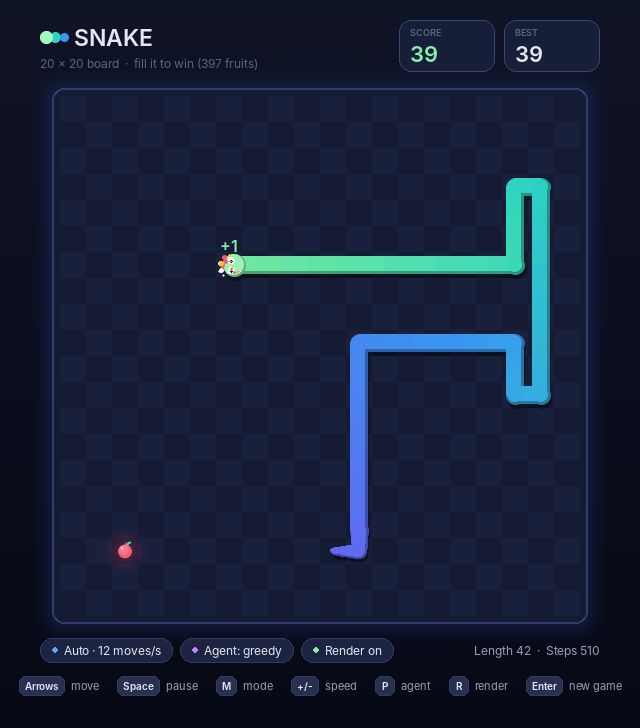

# Snake game

A Snake game built to train AI agents: an exact, deterministic engine, Gymnasium
environments (one game, or thousands stepped together with NumPy) and an animated
pygame front-end that can be switched off whenever you don't need it.

<p align="center">
  
  &nbsp;
  
</p>

- [Install](#install)
- [Play](#play)
- [Rules](#rules)
- [Game modes](#game-modes)
- [Game state for AI](#game-state-for-ai)
- [Observations](#observations)
- [Gymnasium environments](#gymnasium-environments)
- [Concurrency](#concurrency)
- [Rendering on and off](#rendering-on-and-off)
- [Built-in policies](#built-in-policies)
- [Performance](#performance)
- [Package layout](#package-layout)

## Install

From the repository root:

```bash
pip install -e ".[ui]"    # the game plus its window (pygame-ce)
pip install -e .          # headless: engine and environments only (numpy, gymnasium)
pip install -e ".[dev]"   # everything plus pytest; run the tests with `pytest`
```

Python 3.10 or newer. Nothing imports pygame unless something is actually drawn,
so training machines don't need a display or SDL.

## Play

```bash
python -m snake_game                          # step mode: the snake moves one cell per key press
python -m snake_game --mode auto --speed 10   # classic Snake: it keeps moving by itself
python -m snake_game --agent greedy --mode auto              # watch a built-in agent
python -m snake_game --agent hamiltonian --mode auto --speed max  # a perfect game
python -m snake_game --agent my_package.my_module:my_policy  # watch your own agent
python -m snake_game --help                   # board size, seed, cell size, ...
```

(`snake-game` is installed as an alias of `python -m snake_game`.)

| Key | Action |
| --- | --- |
| Arrows / WASD | Steer. In step mode every press moves one cell (hold to repeat). |
| Space | Step mode: make one move (the agent's, or straight ahead). Auto mode: pause / resume. |
| M | Switch between step mode and auto mode. |
| + / - | Auto-mode speed: 1 to 500 moves per second, then MAX. |
| P | Switch player: you or the agent (steering also takes control back). |
| R | Rendering on / off. The game keeps running, as fast as the speed allows. |
| Enter | New game. |
| H | Show all controls (auto mode pauses meanwhile). |
| Esc | Quit. |

The window is resizable. Moves are animated (the snake slides between cells),
eating bursts into particles, crashing shakes the board, and a filled board ends
in confetti.

## Rules

- The board is `width x height` cells, 20 x 20 by default. Positions are `(x, y)`
  with `x` growing to the right and `y` growing **down** (screen coordinates), so
  `Direction.UP` decreases `y`. NumPy arrays are indexed `[y, x]`, flat cell
  indices are `y * width + x`.
- The snake starts with 3 segments, lying horizontally in the middle of the
  board and heading right (on 20 x 20: head `(10, 10)`, then `(9, 10)` and
  `(8, 10)`). One fruit is placed at random.
- Every step moves the head one cell. Asking to reverse onto the neck is ignored:
  the snake goes straight on.
- Leaving the board or running into the body ends the game (`DeathCause.WALL` /
  `DeathCause.SELF`). The cell the tail is leaving is free, so the head may chase
  its own tail. On a fatal step the snake stays at its last legal position and
  `StepResult.collision` tells where it tried to go.
- Eating a fruit scores **one point** and grows the snake by one segment. The next
  fruit appears on a uniformly random free cell.
- The game is **won** when the snake covers the whole board (a score of
  `width * height - 3`, i.e. 397 on 20 x 20).

Fruit placement is the only randomness. It is deterministic given a seed: the
`k`-th fruit of an episode is the `k`-th output of a SplitMix64 stream keyed by the
episode, so a game is fully reproducible from its seed and its moves.

## Game modes

The engine itself only moves when told to: one `step()` is one action and one
frame. `GameController` adds real time on top of it, and the window uses it.

- **Step mode** (`GameMode.STEP`, the default): the snake never moves by
  itself. `steer(direction)` moves it one cell; `advance()` lets the attached
  policy make one move.
- **Auto mode** (`GameMode.AUTO`): the snake moves forward on its own at `speed`
  moves per second while `update(dt)` is fed the elapsed time. Steering inputs
  are buffered (a quick double turn is not lost); with no input the snake keeps
  its heading; with a policy attached, the policy picks every move. `speed` can be
  changed at any time, including to `UNLIMITED`.

```python
from snake_game import Direction, GameController, GameMode, SnakeGame

controller = GameController(SnakeGame(seed=0), mode=GameMode.AUTO, speed=8)
controller.steer(Direction.UP)        # buffered: applied on the next move
results = controller.update(0.25)     # 0.25 s at 8 moves/s -> 2 moves
```

## Game state for AI

`SnakeGame` is a plain, fast, deterministic object; `game.state()` returns an
immutable `GameState` snapshot of everything there is to know:

```python
from snake_game import Direction, SnakeGame

game = SnakeGame(seed=42)                 # SnakeGame(width=..., height=..., initial_length=...)
result = game.step(Direction.UP)          # StepResult(direction, ate_fruit, status, death_cause, collision)
state = game.state()

state.snake               # ((10, 9), (10, 10), (9, 10))  segment positions, head first
state.fruit               # (x, y), or None once the board is full
state.direction           # Direction.UP
state.segment_directions  # (UP, UP, RIGHT): where each segment is heading
state.score, state.steps, state.steps_since_fruit, state.status, state.death_cause
state.to_dict()           # JSON-ready, e.g. to log a trajectory frame by frame
```

`segment_directions` describes how consecutive segments sit relative to each
other: for the head it is the current heading, for every other segment the
direction pointing to the segment in front of it, so
`snake[k - 1] == snake[k] + segment_directions[k].delta`. Together with the head
position it determines the whole body (a chain code), and it is the direction in
which each segment will move if the snake goes straight.

Useful extras: `game.is_safe(direction)`, `game.safe_directions()`,
`game.clone()` (cheap independent copy for tree search; `clone().reseed(...)` to
sample different future fruits), `pickle` support, `GameState.validate()`, and
`SnakeGame.from_state(state)` / `set_state(state)` to start from any position, e.g.
a curriculum of long snakes.

## Observations

Three exact encodings of a state, all derived from positions (agents never see
pixels). `snake_game.observe(state, obs_type)` encodes a single state; the
environments return them directly.

**`"grid"`** (default): `float32` array of shape `(8, height, width)`:

| Channel | Name | Content |
| --- | --- | --- |
| 0 | `head` | 1 on the head |
| 1 | `body` | 1 on every other segment (tail included) |
| 2 | `fruit` | 1 on the fruit |
| 3 | `countdown` | moves (without eating) until the cell is vacated, divided by `width * height`: head = length / cells, ..., tail = 1 / cells |
| 4-7 | `dir_up`, `dir_right`, `dir_down`, `dir_left` | one-hot heading of each segment, as in `segment_directions` |

**`"coords"`**: a dict of `int32` arrays: `snake` `(cells, 2)` with the `(x, y)` of
every segment from head to tail (`-1` rows after the tail), `segment_directions`
`(cells,)` (`-1` padding), `length`, `direction` and `fruit` `(2,)` (`-1, -1` once
the board is full).

**`"features"`**: 19 `float32` values in `[-1, 1]`, named in
`snake_game.FEATURE_NAMES`: heading (one-hot), head position, fruit and tail
offsets from the head, length, and for each absolute direction whether the next
move there is fatal and how many free cells lie straight ahead.

## Gymnasium environments

```python
import gymnasium as gym
import snake_game  # registers "snake_game/Snake-v0"

env = gym.make("snake_game/Snake-v0", obs_type="grid")      # or snake_game.SnakeEnv(...)
obs, info = env.reset(seed=0)
obs, reward, terminated, truncated, info = env.step(env.action_space.sample())

envs = gym.make_vec("snake_game/Snake-v0", num_envs=1024)  # -> snake_game.VectorSnakeEnv
```

Both `SnakeEnv` and `VectorSnakeEnv` accept:

| Argument | Default | Meaning |
| --- | --- | --- |
| `width`, `height`, `initial_length` | `20, 20, 3` | the board |
| `obs_type` | `"grid"` | `"grid"`, `"coords"` or `"features"` |
| `action_mode` | `"absolute"` | `"absolute"`: `Discrete(4)` = `Direction` (UP, RIGHT, DOWN, LEFT; a reversal acts as straight). `"relative"`: `Discrete(3)` = `RelativeAction` (LEFT, STRAIGHT, RIGHT) |
| `rewards` | `Rewards()` | `fruit=1.0`, `death=-1.0`, `win=0.0` (bonus for completing the board), `step=0.0` |
| `max_steps_without_fruit` | `"auto"` | truncate after this many steps without eating; `"auto"` = `width * height` (enough for a Hamiltonian-cycle strategy), `None` = never |
| `render_mode` | `None` | `None`, `"human"` or `"rgb_array"` |

The game itself only ends by collision or by filling the board (`terminated`);
the time limit is an environment-level `truncated`.

`info` (arrays in the vector environment) holds `score`, `length`, `steps`,
`steps_since_fruit`, `won`, `hit_wall`, `hit_self` and `action_mask`: the
actions that do not lose immediately (the reversal is always masked; if every
move is fatal all non-reversal actions are allowed, so the mask is never empty).
`env.action_masks()` returns the same mask, as expected by maskable-PPO
implementations.

`SnakeEnv` exposes the underlying game as `env.unwrapped.game` and accepts
`reset(options={"state": game_state})` to start from any position.

### VectorSnakeEnv

`VectorSnakeEnv(num_envs, ...)` keeps all games in a few `(num_envs, cells)`
NumPy arrays instead of Python objects and advances them with vectorised
operations (moving writes one timestamp per game; the body, its order and the
`countdown` channel all follow from the timestamps). It implements Gymnasium's
`VectorEnv` API, so vector wrappers such as `RecordEpisodeStatistics` work, and
it plays **exactly** the same games as the single environment: after
`reset(seed=s)`, game `i` is `SnakeEnv().reset(seed=s + i)`, move for move,
including the episodes started by autoreset. The tests check this equivalence
for every observation type and action mode.

- `autoreset_mode`: `"NextStep"` (default, Gymnasium's convention: the step after
  an episode ended resets that game, ignores its action and returns reward 0),
  `"SameStep"` (the reset happens within the same step; the last observation
  and info are in `infos["final_obs"]` / `infos["final_info"]`; Gymnasium's
  `RecordEpisodeStatistics` handles this mode from Gymnasium 1.4) or
  `"Disabled"` (reset finished games with `reset(options={"reset_mask": mask})`).
- `reset(seed=...)` takes an int (game `i` gets `seed + i`), one seed per game,
  or `None` (every game continues its own random stream).
- `envs.state(i)` returns the exact `GameState` of game `i`.

## Concurrency

Reinforcement learning wants many games at once, so the package is built for it:

- **Batched stepping**: `VectorSnakeEnv` runs thousands of games per step in one
  process (see [Performance](#performance)); this is the fastest option.
- **Processes**: environments and games hold no global state and pickle cleanly,
  so `gymnasium.vector.AsyncVectorEnv([lambda: SnakeEnv(...)] * n)` works too
  (and produces the same games as `VectorSnakeEnv` with
  `autoreset_mode="NextStep"`).
- **Threads**: independent games share nothing, so separate games (or
  environments) can be driven from separate threads. Draw from one thread only:
  pygame is not thread-safe.
- **Reproducibility**: every game has its own counter-based random stream, so
  results never depend on how games are batched, scheduled or split across
  workers.
- **Search**: `SnakeGame.clone()` copies a game in microseconds for tree search
  or rollouts; `pickle` moves states between processes.

## Rendering on and off

Rendering is optional everywhere and costs nothing when unused:

- In the window, **R** turns drawing off and on; the game keeps running (in
  auto mode at the chosen speed, up to MAX) and a small status panel shows the
  moves per second, scores and games played. Start with `--no-render` to begin
  without drawing; `--auto-restart` keeps an agent playing game after game.
- `SnakeEnv(render_mode="human", render_fps=10)` animates every move in a window;
  set `env.unwrapped.render_enabled = False` (or press **R** in that window) to
  train at full speed, and turn it back on later to watch. Closing the window
  just turns rendering off. **+**/**-** in the window change the animation speed.
- `VectorSnakeEnv(render_mode="human", render_env=0)` shows a live, non-blocking
  preview of one game while training (redrawn at most `render_fps` times per
  second).
- `render_mode="rgb_array"` returns `(H, W, 3)` frames, e.g. for
  `gymnasium.wrappers.RecordVideo`.
- To watch your own policy (any `callable(GameState) -> Direction`):

  ```python
  from snake_game.ui import play
  play(agent=my_policy, agent_name="mine", mode="auto", speed=15)
  ```

## Built-in policies

`snake_game.policies` contains reference players used by the window's agent
mode, by the tests and as baselines. They are not the project's AI.

| Name | Strategy | Typical result on 20 x 20 |
| --- | --- | --- |
| `random` | random move among the non-fatal ones | dies after a handful of fruits |
| `greedy` | shortest path to the fruit, avoiding moves that leave too little room | about 100 points, then traps itself |
| `hamiltonian` | follows a cycle through every cell | always fills the board (397 points, ~41,000 moves) |

## Performance

`python -m snake_game.benchmark` measures environment steps per second with
random actions, observations included. On the (modest) machine used for
development:

| Environment | `grid` | `coords` | `features` |
| --- | ---: | ---: | ---: |
| `SnakeEnv` | 16,000 | 22,000 | 11,000 |
| `VectorSnakeEnv(64)` | 119,000 | 162,000 | 120,000 |
| `VectorSnakeEnv(256)` | 208,000 | 362,000 | 235,000 |
| `VectorSnakeEnv(1024)` | 246,000 | 648,000 | 359,000 |

The bare engine (`SnakeGame.step`) runs at roughly 300,000 moves per second in a
single Python thread.

## Package layout

| Module | Contents |
| --- | --- |
| `engine.py` | `SnakeGame`, `GameConfig`, `GameState`, `StepResult`, `Direction`, `RelativeAction` |
| `controller.py` | `GameController` and `GameMode`: step mode and auto mode |
| `observations.py` | the `grid`, `coords` and `features` encodings |
| `env.py` | `SnakeEnv` (Gymnasium) and `Rewards` |
| `vector_env.py` | `VectorSnakeEnv`, the batched NumPy implementation |
| `policies.py` | built-in reference policies |
| `_rng.py` | counter-based random numbers shared by both engines |
| `ui/` | pygame front-end: `app.py` (window), `renderer.py` (animated board), `viewer.py` (environment rendering), `hud.py`, `effects.py`, `theme.py` |
| `benchmark.py` | throughput benchmark |
| `__main__.py` | command line |
